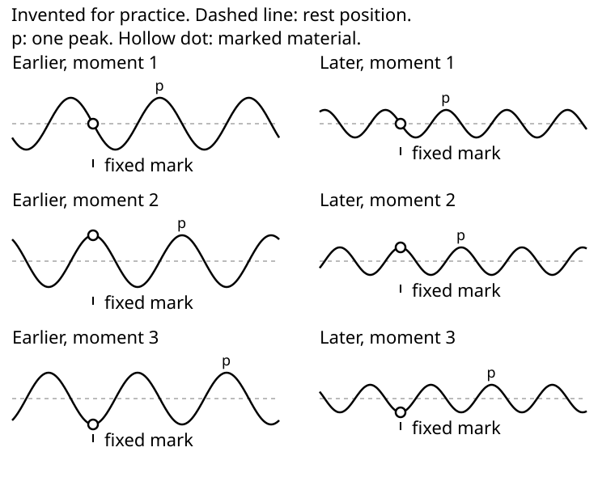

# Day 54: Connect our models to evidence

## Teacher page

### Before class

Prepare day 53 exit, comparison and transfer feedback, including s03-P53-return. Print integrated pages with Side 2 covered and pond slips separate. Keep adult answers private. Lay out familiar cork records, class keys and individually revised portfolios. Use no new apparatus. Retain original and revised versions together.

### Safety and set-up

Paper work only; no water, light or sound apparatus. Preserve privacy during feedback. Public talk is optional. File papers during the existing revision block; no equipment cleanup.

### The day

#### 10 min. Return and repair

Return day 53's exit and notes. First five minutes: [[s03-P54-return]] on complete personal logs. If many, more than ten, show error C or error D, apply both criteria to each condition together. Second five minutes: revisit each child's s03-P53-compare failure/change link. Error F needs an evidence-linked change rather than decoration. Ready children label evidence. Review day 27 retest: a proposed change still needs testing. Never supply the dock answers.

#### 15 min. Anchor consensus

Return to the cork and the unshouted-field message problem. Review day 42 local motion, amplitude and wavelength; review day 45 energy/pattern travel. Review day 48 agreed code key and encode/send/receive/decode chain. Revisit observations before explanations. **Ask.** [[s03-P54-anchor]]

[[steps:s03-P54-anchor]]

Hear a rotating six at forty-five seconds each within five minutes. In the other ten, children compare the familiar models and write individual explanations; attach dated evidence tags to board questions. Distinguish physical repetition from chosen message meanings. If using fallback W, announce it as invented for practice and retain missing firsthand evidence. Keep height and spacing labels on separate familiar records; no fresh pond/grid practice. Do not claim a cork can never drift.

#### 10 min. Portfolio revision

Return day 53 originals and private component feedback: s03-T53-alternatives, s03-T53-comparison, s03-T53-trials, s03-T53-improvement, s03-T53-encode, s03-T53-decode and s03-T53-voice. Review grade 3 second-color revision, preserving original observations and initials. Each child revises independently; attach revised day 48 research and day 50 proposals, plus days 51/52 logs and day 53 notes. Do not share a completed response. New day 54 work earns no portfolio points; revisions clarify earlier records. Collect for first scoring day 55. Record unresolved evidence needs.

#### 5 min. Pattern connections

Use [[s03-P54-sort]]. Read the two familiar statements below. Children sort on paper, then each partner may explain for forty-five seconds. Review physical repetition versus agreed meaning. Review grade 3 design cycle and attach both-condition tests to its compare step. No new transfer model or light-wave account.

#### 5 min. Exit E54

Reveal Side 2 and [[s03-X54a]] on the half slip. Children model from the unseen frames, then complete [[s03-X54b]] in the page's Exit box. No teacher answer is displayed. Collect both. After class allow thirty times forty-five seconds, 22.5 minutes, for the two exit components; thirty seconds each, fifteen minutes, for anchor/sort feedback. Use shown, shown with help, not yet seen. Return exits day 56; anchor/sort notes day 55, without repair then.

### Other rooms

No printer: copy frames and fields; conceal them until exit time. A board holds familiar consensus evidence. Preserve individual responses and private feedback.

### At home

**Swap.** Copy familiar records and conceal the reserved frames and Exit box. Use a different pencil mark for revisions.

**Skip.** Public consensus round and peer sharing.

- **5 min. Return.** Do [[s03-P54-return]] and review failure/change feedback.
- **10 min. Anchor.** Do [[s03-P54-anchor]] using familiar evidence.
  **Say.** "Which record supports your explanation?" Expect a dated observation or trial, with supplied records labeled invented.
- **10 min. Revise.** Correct day 53 transfer privately; preserve originals.
- **5 min. Connect.** Do [[s03-P54-sort]].
- **5 min. Exit ticket.** Reveal frames, [[s03-X54a]] and [[s03-X54b]]; child answers alone.

### Shorter or longer

Shorten public voices, retaining individual anchor evidence, revision and both exit tasks. Extend by naming a board question still lacking evidence.

### Words and supports

Review amplitude, wavelength, local motion, code key and retest. A scribe preserves personal reasoning. Frame: "This evidence answers ___ because ________________________________________________."

### Tomorrow

Day 55 returns day 54 anchor/sort feedback without repair. Keep E54 error A, error B and error E for day 56. Day 55 collects unscored fresh diagnostics and selects earlier revised evidence for first scoring. No new scored work or practical round.

### Credit

Ours. Background: Source U3-waves, Source U3-patterns and Source U3-design.

## Student page

### Side 1

I can explain our observations and message systems using evidence.

**Review.**

[[s03-P54-return]]

________________________________________________

**Anchor explanation.**

[[s03-P54-anchor]]

{work}

Board question: ___ Evidence tag: ___

This evidence answers ___ because ________________________________________________.

Still unanswered: ___

**Pattern connections.**

[[s03-P54-sort]]

| Familiar statement | Physical repetition or agreed meaning? |
|---|---|
| Cork bobs repeatedly. | |
| Our symbol means BEND. | |

### Side 2

**Keep covered until your own exit turn.**

Invented for practice. Use these frames with your separate pond-model half slip.

**Exit box.**

[[s03-X54b]]

{work}
