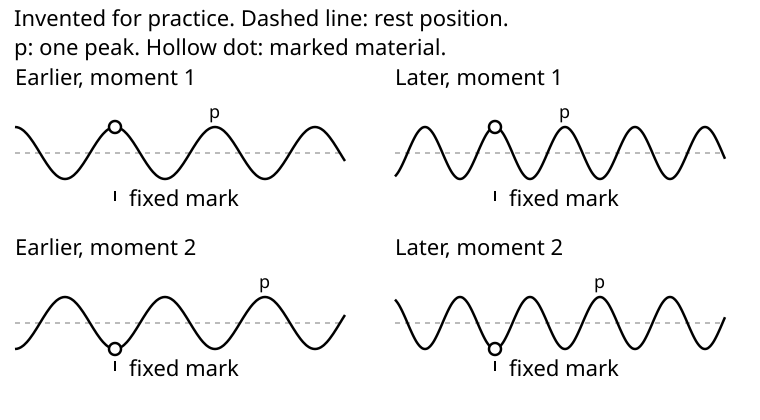

# Day 55: Fresh diagnostics and earlier evidence

## Teacher page

### Before class

Print integrated pages and private answers. Collate day 46 originals/day 47 revisions; day 53 originals/day 54 revisions; day 48 research, day 50 proposals/peer notes, days 51/52 logs and day 53 comparisons. Prepare day 54 notes for return at collection without repair. Keep E54 sealed for day 56. Cover question board and pattern chart.

### Safety and set-up

Paper only; leave equipment stored. Keep diagnostics separate from earlier portfolios. Final collection includes three cleanup minutes.

### The day

#### 3 min. Independent launch

Review grade 3 independent assessment: own work, no coaching or feedback. Read directions neutrally. Fresh cases are invented for practice and unscored. Earlier evidence is first scored after class. No builds, interviews or new scored answers.

#### 15 min. Fresh wave diagnostic

Each child independently completes [[s03-D55-wave]] from the unseen rope frames. Offer neutral reading, enlarged frames or a scribe without reasoning help. Keep responses for day 56; no answer discussion.

#### 20 min. Fresh code diagnostic

Each child independently completes [[s03-D55-codes]] and [[s03-D55-picture]]. No peer help, apparatus or feedback. Record access support separately from reasoning.

#### 4 min. Earlier-evidence selection

Use [[s03-E1]], seven [[s03-E2-alternatives]] through [[s03-E2-voice]] component rows, and [[s03-E3]]. Return the earlier logs for selection. Children point to originals and revisions; write nothing new. Return day 53 s03-P53-compare, s03-T53-alternatives, s03-T53-comparison, s03-T53-trials, s03-T53-improvement, s03-T53-encode, s03-T53-decode and s03-T53-voice for selection. Locate day 46/day 47 wave records; day 53/day 54 dock records; day 48, day 50, day 51 s03-P51-log, day 52 s03-P52-log and day 53 personal design evidence. New day 54 work and today's additions earn no points.

#### 3 min. Collection

Return day 54 s03-P54-anchor, s03-P54-sort and s03-P54-return notes without repair. Collect diagnostics apart from portfolios. After class allow thirty times sixty seconds, thirty minutes, for first portfolio scoring: eight wave, twelve code, four engineering points. Apply generated component keys; never double-count item 2 within item 3. Mark unavailable firsthand performance unscored, not zero or demonstrated by invented analysis. Allow thirty times thirty seconds, fifteen more minutes, for diagnostic notes. Return feedback day 56.

Teacher only, one copy per child. Use points only here. Formative observations remain on the separate three-category record.

Child: ___ Evidence locations: ___

| Component | Maximum | Points | Evidence/next step |
|---|---|---|---|
| Wave model E1 | 8 | | |
| Alternatives | 2 | | |
| Comparison | 2 | | |
| Trials | 2 | | |
| Improvement | 2 | | |
| Encode | 1 | | |
| Decode | 1 | | |
| Voice | 2 | | |
| Personal design E3 | 4 | | |

Unscored components: ___ Missing firsthand evidence: ___

### Other rooms

No printer: copy unseen frames and prompts privately; children answer on folded paper. Read neutrally. Keep earlier evidence identifiable.

### At home

**Swap.** Copy unseen frames and prompts; gather earlier originals and revisions.

**Skip.** Public sharing, equipment and repeated copies.

- **15 min. Assessment.** Child independently answers [[s03-D55-wave]]. Read neutrally without hints.
- **20 min. Assessment continued.** Child answers [[s03-D55-codes]] and [[s03-D55-picture]] alone. Keep fresh responses separate.
- **4 min. Earlier evidence.** Locate [[s03-E1]], all seven item 2 component records and [[s03-E3]]. Add nothing to them.
- **1 min. Collect.** Preserve both sets for next-day feedback.

### Shorter or longer

Preserve each allocation. Record unfinished responses honestly. Early finishers quietly check their own fresh work; no extension is judged.

### Words and supports

Review amplitude, wavelength, encode and decode. Read printed wording only. A scribe records the child's explanation without choosing features or solutions.

### Tomorrow

Day 56 responds once to day 55's assessment and unscored diagnostics, with E54 also returned. Route error A/error B to waves, error C/error D to comparisons, error E to shared rules and error F to failure/change. No portfolio rescoring.

### Credit

Ours. Background: Source U3-waves, Source U3-patterns and Source U3-design.

## Student page

### Side 1

I can apply my models to fresh records.

**Fresh wave record, unscored.**

[[s03-D55-wave]]

{work}

**Earlier evidence, both sides.**

Scored from the work you handed in. Write nothing here.

[[s03-E1]]

### Side 2

**Fresh codes, unscored.**

[[s03-D55-codes]]

Code one, STOP: ___ GO: ___ Boundary: ___

Code two, STOP: ___ GO: ___ Boundary: ___

Needed evidence: ______________________________________

[[s03-D55-picture]]

<table style="width:1.5in" aria-label="Two-by-two picture"><tr><td></td><td></td></tr><tr><td></td><td></td></tr></table>

**Earlier evidence, continued.**

- [[s03-E2-alternatives]]
- [[s03-E2-comparison]]
- [[s03-E2-trials]]
- [[s03-E2-improvement]]
- [[s03-E2-encode]]
- [[s03-E2-decode]]
- [[s03-E2-voice]]
- [[s03-E3]]
