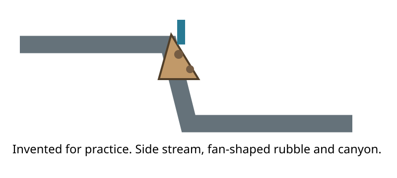

# Day 57: A river below high walls

## Teacher page

### Before class

Prepare the integrated observation-sheet.md, family.md and reserved stimulus from exit-57.md. Use generated slips rather than that piece's combined layout. Keep Side 2 covered. Open canyon-photo.jpg without explanatory captions. Keep hook.svg for an unclear photograph. Prepare the question board and private teacher-key.md. Return day 56's written formative notes with folders; keep readiness uncorrected for day 59.

### The day

#### 10 min. opening

Return day 56 written tasks with notes; file without repair time.

Honor day 56's Tomorrow: show canyon walls and the river, without teaching erosion. Children look silently, then begin [[s04-P57-notice]]. Review observation and inference from day 16: what is visible differs from a possible explanation. Point to the river if hard to locate; accept uncertainty about hidden features. If the image remains unclear, show hook.svg and say it is invented for practice. Give the family note.

#### 15 min. Notice and draw

Alone, finish the two observations, then [[s04-P57-initial]]. **Ask.** Use the initial-model prompt before discussing any explanation. Expect a tentative change account with one uncertainty, not an established cause. Review cause-and-effect arrows: an arrow suggests how a change could happen. Do not supply a finished model. Visit children who confuse guesses with observations; point back to a visible feature. Retain first models for later revision.

#### 3 min. Slow-change retrieval

Review slow change from grade 3 day 84, using [[s04-P57-slow]]. Expect many small removals could accumulate; no exact duration follows. A miss gets a brief sequence sketch of small repeated removals, not a numerical age. State: Earth's rocks preserve evidence of a very old Earth. Today's photograph cannot give an exact age.

#### 12 min. Group questions

Review the question board routine from day 42. Alone, [[s04-P57-questions]]. Partners each take 45 seconds to connect their question to an observation; all pairs work simultaneously. Passing in public is allowed. Hear a rotating six, 45 seconds each, within five minutes. Group written questions under missing material, wall stripes and time. Leave causes open; collect every child's question. Do not introduce blockage cases.

#### 5 min. Exit

Reveal Side 2 and its invented exit-57.svg only now. Children independently complete [[s04-X57-model]] on the half slip and [[s04-X57-question]] in the Exit box. Read stems neutrally; no public rehearsal. Collect slips and pages. After class, allow 30 times 35 seconds, 17.5 minutes, for both exit responses; 30 times 30 seconds, 15 minutes, for practice notes. Use record.md: shown, shown with help, not yet seen. Return all on day 58.

### Other rooms

No projector: use a large print of the photograph. No printer: copy prompts and draw the invented hook and reserved stimulus at their separate times. Keep exit prompts covered. A scribe records the child's reasoning.

### At home

**Swap.** Without projection, point to the photograph. Without printing, copy prompts and drawings.

**Skip.** Public reports and the class board.

- **5 min. Look.** Do [[s04-P57-notice]].
  **Say.** "What can you actually see?" Expect the river below walls and visible stripes.
- **12 min. Draw.** Do [[s04-P57-initial]]. Let the child keep an uncertain idea.
- **3 min. Slow change.** Do [[s04-P57-slow]]. Expect small changes could add up.
- **5 min. Wonder.** Do [[s04-P57-questions]]. Adult listens without supplying a cause.
- **7 min. Exit ticket.** Reveal the reserved drawing. Child completes [[s04-X57-model]] and [[s04-X57-question]] alone.

### Shorter or longer

Shorten public sharing; retain individual observations, model, question and exit. Extend by adding uncertainty marks to the same model.

### Words and supports

Tentative means open to change. Review observation, inference and slow change. Frame: "I notice ______________________________________. Maybe ______________________________________." Accept labeled drawings or dictation.

### Tomorrow

Day 58 returns every paper in Return. If many treat a tentative account as proof, separate visible labels from inferred arrows. Missing observations get a point-to-feature repair. Then distinguish breaking from carrying using process records.

### Credit

Ours. Photograph: Alex Demas, public domain, Source U4-canyon-photo. Background: [Source U4-canyon](https://www.nps.gov/grca/learn/nature/geologicformations.htm). Original fallback and exit drawings: Source U4-original.

## Student page

### Side 1

I can observe a canyon, draw a first explanation and ask a question.

**Notice.**

[[s04-P57-notice]]

________________________________________________

**First explanation.**

[[s04-P57-initial]]

{sketch}

I notice ______________________________________. Maybe ______________________________________.

**Slow change.**

[[s04-P57-slow]]

________________________________________________

**Wonder.**

[[s04-P57-questions]]

________________________________________________

### Side 2

**Exit box. Keep covered until your own turn.**

Use the separate half slip for your model.

[[s04-X57-question]]

________________________________________________

________________________________________________
