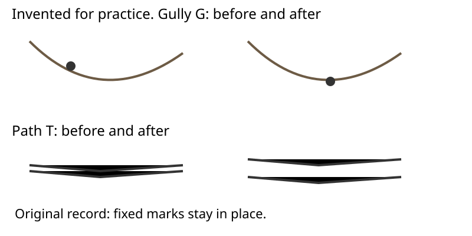

# Day 58: Breaking and carrying leave different evidence

## Teacher page

### Before class

Integrate process-records.md and process-58.svg on one student side. Print generated exit-58.md prompts separately, without its teacher directions. Keep teacher-key.md private. Prepare day 57 observation sheets, first models, slow-change answers, questions and exit feedback for every child. No trip or wet apparatus today.

### The day

#### 5 min. Return

Return day 57's half slip and Exit box (s04-X57-model and s04-X57-question), plus written tasks (s04-P57-notice, s04-P57-initial, s04-P57-slow and s04-P57-questions). If many treated guesses as proof, point to observation labels separately from inferred arrows on their own work. If observations were missing, locate a visible feature. Keep the first model unchanged. Review the question board routine: reopen where missing material might go. This repair replaces opening discussion, never the process examples.

#### 20 min. Process records

Say aloud: these records are invented for practice, not photographs or our field observations. Read both rows before [[s04-P58-sort]]. Review erosion from grade 2: material is carried away. Introduce weathering: rock material breaks down. Sediment means loose pieces of rock or soil.

Alone, mark the feature in each row that supports a process. Partners each take 45 seconds to explain a choice, simultaneously. **Ask.** Use the sort prompt before giving feedback. Expect Gully G's changed grain position to support carrying; its unchanged sizes do not establish new breakage. Path T's wider crack supports breaking while the sides stay in place. For error A, point to the stationary crack; motion is unnecessary for weathering. Give neutral reading or a scribe as needed.

#### 15 min. Trace evidence

Children add arrows on Gully G and outline the changed crack on Path T. Connect each annotation to their existing sort response. Hear six children, 45 seconds each, within five minutes; public passing is allowed. Remaining children keep paper evidence. Distinguish the observation from an inferred cause: these records do not identify what widened the crack. Weathering and erosion can happen together; do not present them as exclusive choices. Keep the two separate practice records; never rehearse a linked missing-fragment case. Collect the annotated page.

#### 5 min. Exit

Reveal [[s04-X58]] from exit-58.md at each child's own independent turn. Read neutrally. Children write on the half slip; no spoken substitute or peer feedback. After class, allow 30 times 30 seconds, 15 minutes, for exits and 30 times 20 seconds, ten minutes, for annotated practice. Use record.md: shown, shown with help, not yet seen. Error A means weathering requires travel; missing evidence alone is not that error. Return all day 59.

### Other rooms

No projector: use the printed records. No printer: copy the two-row record and sketch process-58.svg on the board. Reveal the different exit text only during Exit. No local photographs are required.

### At home

**Swap.** Copy records and prompts if printing is unavailable. Point at the page without projection.

**Skip.** Public reports and the class board.

- **5 min. Return.** Read day 57 feedback. Separate observations from guesses.
- **12 min. Read.** Read the invented records. Child begins [[s04-P58-sort]].
  **Say.** "Which feature supports your choice?" Expect grain position for carrying and a wider crack for breaking.
- **10 min. Trace.** Add arrows and crack outlines to the same response. Explain weathering as breaking down.
- **5 min. Exit ticket.** Reveal [[s04-X58]]. Child writes alone. Save both records for day 59.

### Shorter or longer

Shorten public sharing. Keep both process records and the independent exit. Extend by marking what each record cannot establish.

### Words and supports

Review erosion. Weathering means breaking rock material down. Sediment means loose rock or soil pieces. Frame: "The feature ___ supports ___." Offer enlarged drawings and dictation.

### Tomorrow

Day 59 returns every paper in response. If many show error A, use its sand observation to distinguish carrying from breakage. Preserve all fifteen readiness-response minutes. Then plan a slope comparison and start a freezing comparison.

### Credit

Ours. Original records and drawing: Source U4-original. Background: [Source U4-processes](https://www.nps.gov/articles/000/weathering-erosion.htm).

## Student page

### Side 1

I can use evidence to distinguish breaking from carrying.

**Process records.**

Invented for practice. These are drawings, not photographs of real places.

| Record | Before | After |
|---|---|---|
| Gully G | Marked grains rest above a gully bend. | Those grains lie beyond the bend. Their sizes look unchanged. |
| Path T | A narrow crack separates two fixed marks. | The crack is wider. Both marked sides remain in place. |

[[s04-P58-sort]]

| Record | Process supported | Evidence feature |
|---|---|---|
| Gully G | | |
| Path T | | |

Sediment means loose pieces of rock or soil.

The feature ___ supports ___.

Trace grain travel with arrows.

Outline the changed crack.

Save this page for feedback.
