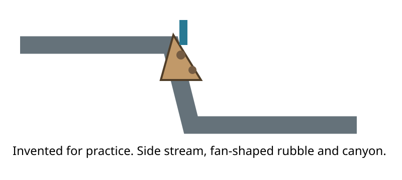

# Day 57 reserved exit

## Items

Teacher: open only on day 57. Half-sheet exit, five minutes. Read neutrally; accept dictated responses. Do not show teacher-key.md.

[[s04-X57-model]]

{sketch}

________________________________________________________________

________________________________________________________________

[[s04-X57-question]]

{sketch}

________________________________________________________________

________________________________________________________________
