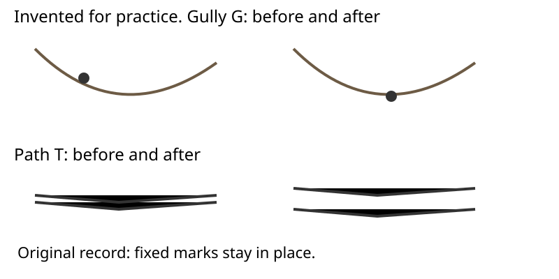

# Two process records

Invented for practice. Original drawings, not photographs of real places.

| Record | Before | After |
|---|---|---|
| Gully G | Marked grains rest above a gully bend. | Those grains lie beyond the bend. Their sizes look unchanged. |
| Path T | A narrow crack separates two fixed marks. | The crack is wider. Both marked sides remain in place. |

[[s04-P58-sort]]

________________________________________________________________

________________________________________________________________

Breaking ____ Carrying ____ Not established ____

