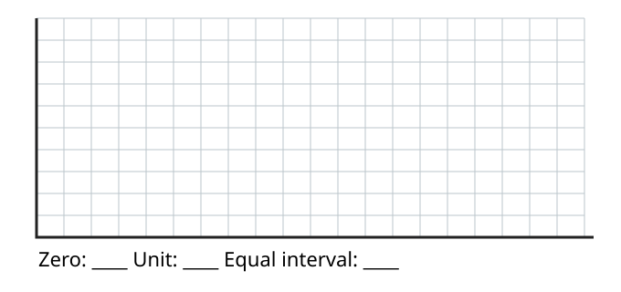

# Day 62: Measurements and cause arrows

## Teacher page

### Before class

Prepare day 61 feedback and day 60 actual measurements. Select one complete paired trial for graphing; retain every other trial in a table. Integrate graph-sheet.md and blank-graph.svg. Reassemble exit-62.md and exit-box-62.md as specified above. Keep Side 2's Exit box covered. Keep teacher-key.md private.

### The day

#### 5 min. Return

Return day 61's s04-X61, s04-P61-clay and s04-P61-abrasion. If many show error A, review weathering from day 58: breaking rock material down, whether pieces travel or stay. Error B needs observed change, with no promise every short trial succeeds. Review erosion from grade 2: wind or water carries material away. Children annotate their own observations, keeping originals.

#### 20 min. Graph observations

Review the dated weather table from grade 3 and bar graph from grade 2: one square is one centimeter, bars start at the bottom line. Begin with [[s04-P62-retrieve]] for three minutes. Then use [[s04-P62-graph]]. Children label a zero-based vertical scale and draw only one actual trial's two bars. Keep all remaining valid trials in the accompanying table. Graph condition and trial labels, not just heights. This two-bar observation display differs from the reserved six-result graph.

Spend four minutes modeling scale and labels, nine on individual graphs, and four comparing graphs with original records. A missing value stays missing. If day 60 readings are unavailable, announce the slope panel of fallback-records.md as invented for practice. Graph one pair only; table the others. Never call it a class measurement. Errors in intervals need equally spaced whole-centimeter marks, not invented extra precision.

#### 15 min. Revise arrows

Review cause-and-effect arrows from day 57. Children complete [[s04-P62-arrows]] from their actual trial notes. Observe first, then attach an observation to the arrow; mark an unsupported link uncertain. Distance tracks carrying; weathering needs evidence of material breaking down. Both may happen, but a distance alone cannot establish both.

Allow five minutes to revise, five for simultaneous partner turns and corrections, five for independent annotations. Partners each take 45 seconds to locate the record supporting their arrow. Public talk may be passed. Preserve conflicting trials. Error C calls for matched conditions and all results. Do not rehearse a six-result overlap or the exit's always claim.

#### 5 min. Exit

Reveal [[s04-X62-graph]] on the half slip, with [[s04-X62-claim]] and [[s04-XB62-process]] in the Exit box. Children answer alone: three minutes graphing, one minute per brief response. Collect slips and pages. After class allow 30 times 50 seconds, 25 minutes, for the exit set and 30 times 20 seconds, ten minutes, for practice feedback. Use record.md: shown, shown with help, not yet seen. Return all day 63.

### Other rooms

No printer: rule squared space and copy today's fields. Reveal exact reserved stems only at Exit. Use the invented fallback only when actual records are missing.

### At home

**Swap.** No squared paper: rule equal squares. No class record: use the labeled slope fallback.

**Skip.** Public reports and feedback distribution.

- **5 min. Return.** Read day 61 feedback and complete [[s04-P62-retrieve]].
- **15 min. Graph.** Complete [[s04-P62-graph]]. Draw two bars; table other trials.
  **Say.** "Which day has the tallest bar?" Expect day two in the retrieval record.
- **10 min. Arrows.** Complete [[s04-P62-arrows]]. Keep observations beside their arrows.
- **5 min. Exit ticket.** Reveal [[s04-X62-graph]], [[s04-X62-claim]] and [[s04-XB62-process]]. Child works alone.

### Shorter or longer

Cut public reports, preserving the scale, individual graph and exit. Extend annotations of unresolved readings without replacing them.

### Words and supports

Review weathering, erosion and evidence. A graph interval is the amount between neighboring scale marks. Offer enlarged squares and a scribe for dictated labels.

### Tomorrow

Day 63 judges causes using repeated results. Return today's three exit responses and practice pages in Return. If many show error C, retain every result and limit the claim. Error A needs carrying separated from breaking.

### Credit

Ours. Invented records: Source U4-original. Background: [Source U4-processes](https://www.nps.gov/articles/000/weathering-erosion.htm).

## Student page

### Side 1

I can graph measurements and revise my cause arrows.

[[s04-P62-retrieve]]

________________________________________________

[[s04-P62-graph]]

Source/date: ___ Conditions: ___ Trial graphed: ___

One interval represents: ___ centimeters.

Other valid trials:

| Trial | Gentle, cm | Steep, cm |
|---|---|---|
| | | |
| | | |
| | | |

Missing readings: _______________________________

### Side 2

[[s04-P62-arrows]]

{small}

Observation: ___ Source/day: ___

**Exit box. Keep covered until Exit.**

Use the flow record on your separate half slip.

[[s04-X62-claim]]

________________________________________________

________________________________________________

[[s04-XB62-process]]

________________________________________________
