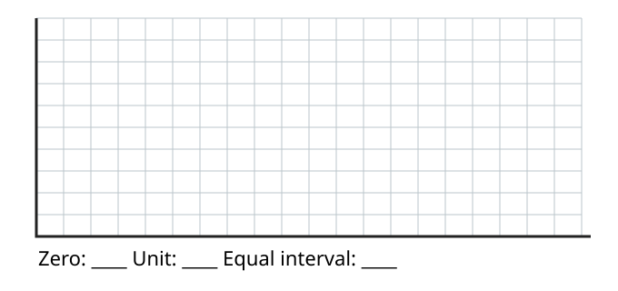

# Graphing class measurements

[[s04-P62-retrieve]]

________________________________________________________________

________________________________________________________________

[[s04-P62-graph]]

________________________________________________________________

________________________________________________________________

Source of readings: ____ Date: ____

Conditions: ____ Units: ____ One interval represents: ____

Record missing readings as missing. Keep every valid trial visible.
