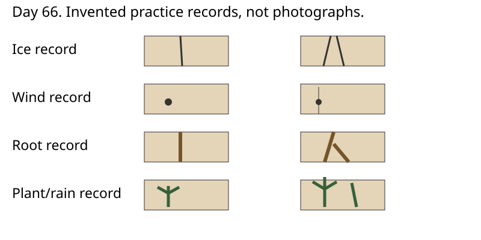

# Day 66 process records

Invented for practice. Original drawings, not real observations.

| Card | Invented record |
|---|---|
| I2 | Frost cycles widen cracks on a standing rock face. Its marked base stays fixed. |
| W2 | Dust streaks lengthen across a wall after wind. No fragment sizes are recorded. |
| R2 | A root grows between rock blocks. The blocks spread apart across fixed marks. |
| P2 | Equal seedlings receive equal light. Added water supports new leaves; dry controls lose leaves. Rain also deepens a separate runoff channel. |

[[s04-P66-records]]

________________________________________________________________

________________________________________________________________
