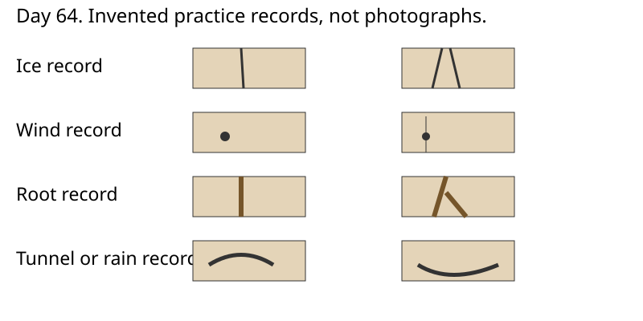

# Separate land-change records

Invented for practice. The dates describe invented records, not actual collected observations.

## Day 64 cards

| Card | Earlier record | Later record |
|---|---|---|
| I | November 2: wet rock S has one narrow crack. | November 7: after freezing, new surfaces separate inside that crack. An unfrozen matched stone stays unchanged. |
| W | November 3: a cliff face has loose dust. | November 4: dust coats a nearby vertical sticky card after wind. A sheltered card has little dust. |
| R | November 1: a root sits inside a marked rock gap. | November 8: root and gap are wider between the same marks. |
| B | November 1: level soil lies beside an empty opening. | November 8: an animal has dug a longer tunnel. The surface above sags. |
| P | November 1: matched water-needing plants share light and soil. | November 8: watered plants grow; unwatered plants dry. No land grooves are recorded. |

[[s04-P64-records]]

________________________________________________________________

________________________________________________________________

