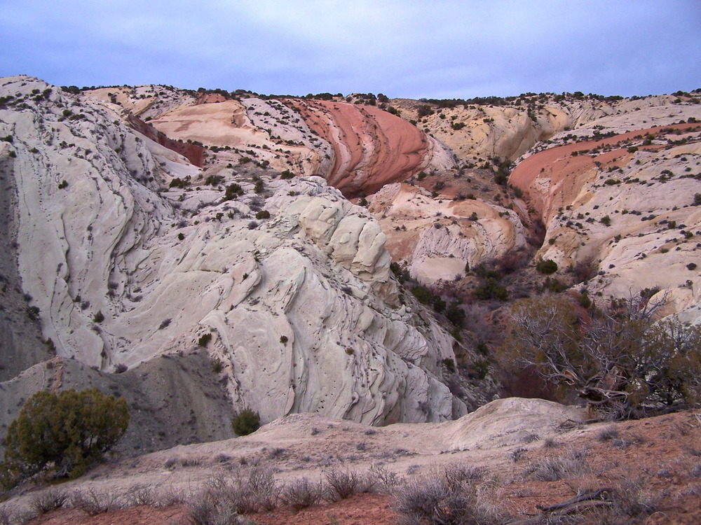

# Day 68: Trace bent and shifted layers

## Teacher page

### Before class

Return marked day 67 papers. Gather saved clay and construction drawings; prepare a second intact stack per group. Open folded-rock.jpg; keep fold-practice.svg as the invented fallback. Print photo-sheet.md image and layer-sheet.md fields once. Prepare exit-68.md with exit-68.svg, concealed. Print teacher-key.md for yourself; use the generated answer key for practice.

### Safety and set-up

Recheck clay ingredients and allergies. Six groups of five share blunt slicers; cut away from hands. Count large tokens out and back. Nothing is tasted. Stagger washing during final work minutes; finish washing, wiping and storage in five Cleanup minutes. Use paper if washing cannot fit.

### The day

#### 5 min. Return

Return day 67's s04-X67 and s04-P67-retrieve, s04-P67-build, s04-P67-cards. If many assumed a middle environment, error x, use their feedback to mark that claim unknown. Review fossil, layer, older, younger and undisturbed from day 67. Compare saved construction drawings with intact models; keep the originals.

#### 15 min. Deform models

Review clay's limits from day 59. Each group gently bends one stack, without overturning it. Slice another stack and shift its halves sideways, preserving upright order. Each child takes a 30-second handling turn; six groups work simultaneously. Spend five minutes changing stacks and ten drawing before/after pairs, [[s04-P68-model]]. Review inferred from day 66. A band had to exist before its bend or shift. These separate finished models cannot establish which group's change happened first. Moderate bending keeps the familiar practice distinct from the unseen overturned exit.

#### 15 min. Trace photograph

Read photo-sheet.md's photograph credit. Source U4-fold-photo identifies Dinosaur National Monument. This is a real exposure, separate from the canyon anchor. Children complete [[s04-P68-photo]]: five minutes tracing one visible band, five comparing its curve with their model, five labeling uncertainty. Partners each have 45 seconds simultaneously, reviewing day 61's evidence pointing; public talk may be passed. The photograph shows bending, but lacks original-top markers. Error F needs attention to traced continuity rather than lowest screen position. If a band cannot be followed, retry once, then mark the gap unresolved. Use the labeled invented fold-practice.svg only as model evidence.

#### 5 min. Cleanup

Count tokens, store models and drawings, wipe surfaces and finish staggered handwashing. Keep all original drawings.

#### 5 min. Exit

Reveal [[s04-X68]] with exit-68.svg only now. Children independently evaluate both diagrams on the half slip. No rehearsed answer or partner check. Collect exits and practice. After class: 30 times 45 seconds, 22.5 minutes, exit marking; 30 times 30 seconds, 15 minutes, practice feedback. Record shown, shown with help, not yet seen on record.md. Return all papers day 69 in Return.

### Other rooms

No clay: draw the same moderate bend and upright offset. No display: use printed photo-sheet.md. No printer: copy fields and draw the exact exit diagram privately before class; uncover it only at Exit.

### At home

**Swap.** Use bent paper strips and a separate shifted stack without clay. Use the printed photograph without a display. Copy fields without a printer.

**Skip.** Class reports and feedback distribution.

- **5 min. Return.** Read day 67 feedback.
- **10 min. Deform models.** Complete [[s04-P68-model]].
- **10 min. Trace photograph.** Complete [[s04-P68-photo]].
  **Say.** "Mark where its original order remains uncertain." Expect a marked gap or missing original-top evidence; screen height alone cannot establish age.
- **5 min. Cleanup.** Store models and wash after clay handling.
- **5 min. Exit.** Reveal [[s04-X68]] with its diagram. Child answers independently before discussing the answer.

### Shorter or longer

Cut public reports; keep both transformations, uncertainty labels and Exit. Extend continuity tracing on the same photograph.

### Words and supports

Bend changes a band's curve; offset shifts its pieces. Deformation means changed shape or position. Accept labeled traces, dictation and enlarged photographs.

### Tomorrow

Day 69 reads canyon evidence and compares different landscape accounts. Return today's papers in Return. Error F needs tracing original band identity through changed positions. A missing uncertainty label, error x, needs the missing evidence named, without guessing tops.

### Credit

Ours. Photograph: National Park Service, public domain, [Source U4-fold-photo](https://npgallery.nps.gov/AssetDetail/2a050091-1dd8-b71b-0b51-e9ef0b553a4f). Background: [Source U4-order](https://geology.utah.gov/map-pub/survey-notes/rock-dating/). Invented models: Source U4-original.

## Student page

### Side 1

I can trace patterns through bent and shifted layers.

[[s04-P68-model]]

Original stack:

{small}

Moderate bend:

{small}

Separate upright shifted stack:

{small}

### Side 2

Photograph: National Park Service, public domain. Source U4-fold-photo.

[[s04-P68-photo]]

My band trace and uncertainty marks:

{small}

Clay bends easily. Rock changes over different times and conditions.

Keep this record and your original construction drawing.
