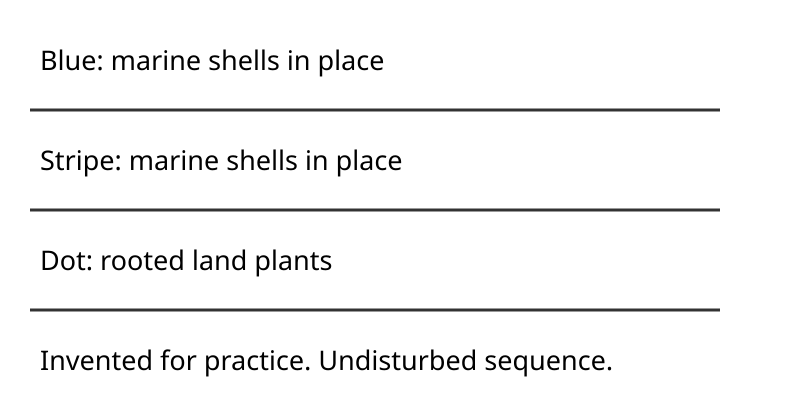

# One earlier environment sequence

Invented for practice. These are original practice cards, not a real exposure.

All three layers are undisturbed. The lower layer was there before the higher layers.

| Position | Label | Evidence |
|---|---|---|
| Upper | Blue | Marine shell fossils remain in place. |
| Middle | Stripe | Marine shell fossils remain in place. |
| Lower | Dot | Land-plant roots remain in their soil layer. |

[[s04-P67-cards]]

________________________________________________________________

________________________________________________________________

Evidence links:

{sketch}

