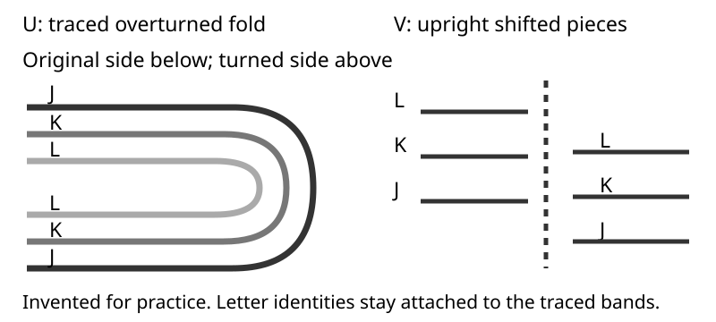

# Day 68 reserved exit

## Items

Teacher: open only on day 68. Half-sheet exit, five minutes. Read neutrally; accept dictated responses. Do not show teacher-key.md.

[[s04-X68]]

________________________________________________________________

________________________________________________________________
