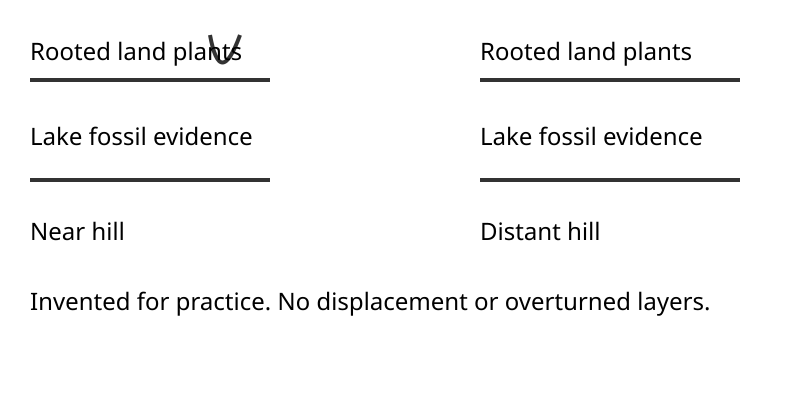

# Comparing practice histories

Invented for practice. Original records, not a real landscape.

An undisturbed two-layer hill has lake-living fossil evidence in lower dotted rock. Rooted land plants occur in the upper striped rock. The same ordered fossil pattern appears at a distant hill. A shallow modern drainage groove cuts only the upper layer.

Account A: lake conditions came before land conditions.

Account B: land conditions came before lake conditions.

[[s04-P69-accounts]]

________________________________________________________________

________________________________________________________________

| Account | Supporting evidence | Conflict or uncertainty |
|---|---|---|
| A | | |
| B | | |

No exact duration is supplied.

