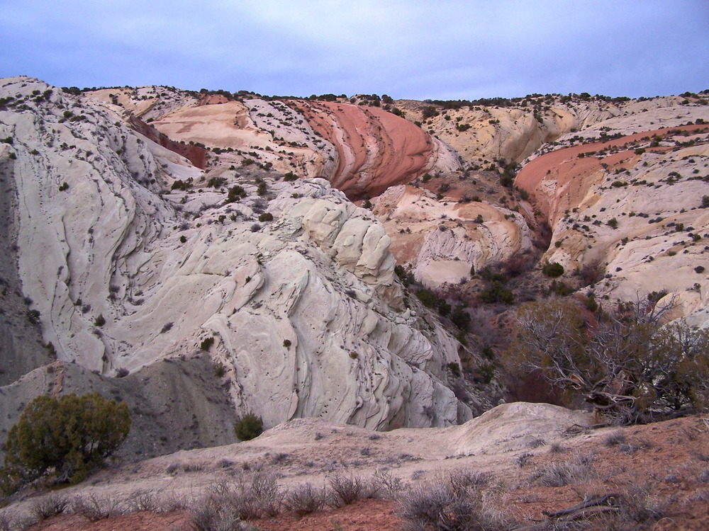

# Tracing a real folded exposure

Photo: National Park Service, public domain. Source U4-fold-photo.

This is Dinosaur National Monument, not the Grand Canyon.

[[s04-P68-photo]]

________________________________________________________________

________________________________________________________________

If the photo cannot display, use fold-practice.svg, invented for practice. It is model evidence, not a photograph. This view alone need not reveal original tops.

{sketch}
