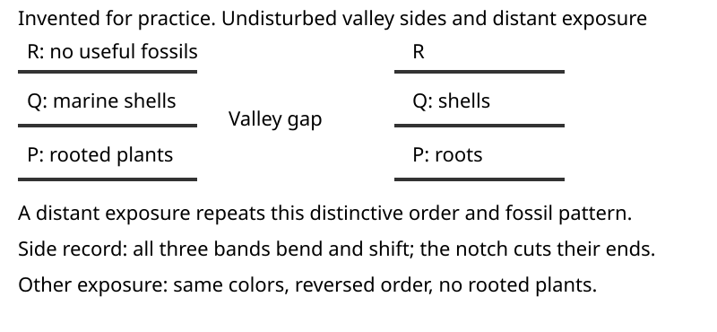

# Day 72: a new valley history

Teacher: keep sealed until day 72. Original diagrams and records are invented for practice. Read prompts neutrally. Keep the classroom model visible only for independent checking, without feedback.

[[s04-E2-order]]

{sketch}

________________________________________________________________

________________________________________________________________

[[s04-E2-match]]

{sketch}

________________________________________________________________

________________________________________________________________

[[s04-E2-deform]]

{sketch}

________________________________________________________________

________________________________________________________________

[[s04-E2-cut]]

{sketch}

________________________________________________________________

________________________________________________________________

[[s04-E2-limit]]

{sketch}

________________________________________________________________

________________________________________________________________
