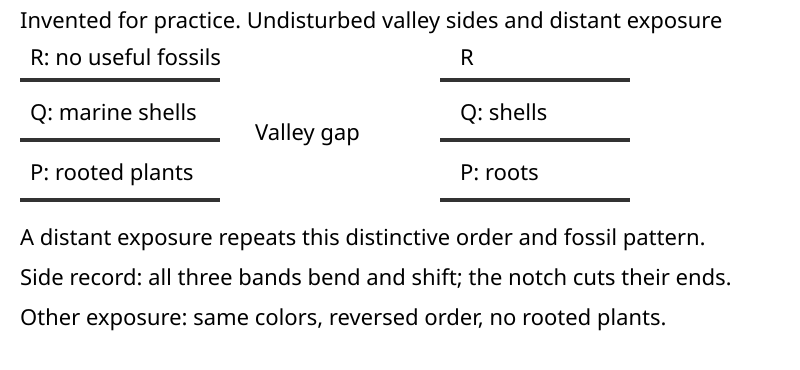

# Day 72: Explain an unfamiliar valley

## Teacher page

### Before class

Keep assessment-72.md and assessment-valley.svg sealed until Launch. Prepare the integrated two-sided page without duplicate stems or teacher directions. Print teacher-key.md and assessment-record.md for yourself; generated answers hold current items. Keep the earlier revised class model covered until Evidence check. Hold day 71 feedback until day 73.

### Safety and set-up

Paper only; no apparatus. Arrange independent working spaces beforehand. Put papers into the assessment folder during three Collection minutes. Use only the supplied landscape, without personal home or family accounts.

### The day

#### 3 min. Launch

After day 71's independent erosion assessment, this is the separate history assessment. Reveal the new record. State aloud: the diagrams and records are invented for practice. Read directions neutrally. Children may label drawings or dictate their own reasoning. Explain no answers or evidence choices. Keep earlier model answers concealed.

#### 32 min. History explanation

Children work independently: ten minutes [[s04-E2-order]], seven [[s04-E2-match]], five [[s04-E2-deform]], five [[s04-E2-cut]], five [[s04-E2-limit]]. Every claim must use the supplied evidence. Use the diagram for layer identity and the printed stems for the full side records. The children have not seen this valley before today.

Permit neutral rereading, enlarged print and a scribe recording the child's words. Do not order events, point out a fossil pattern or supply a missing limit. Note access support separately. No peer discussion, answer display, feedback or revision from teacher comments before scoring.

#### 7 min. Evidence check

Reveal only the earlier revised class model, without this valley's answers. Children independently check their own evidence links against its general model. They may annotate their own work before collection. No teacher evaluation or reteaching occurs. Keep both the original and any independent additions visible.

#### 3 min. Collection

Collect every page and clear desks. After class allow 30 times two minutes, 60 minutes, to mark and write component feedback. Use assessment-record.md only: 2 complete evidence link, 1 relevant but incomplete, 0 attempted without the link. Blank means absent or not observed. Six components total twelve possible points. Return feedback day 73; originals enter Revision then. Do not change original scores after later repair.

### Other rooms

No display: use printed assessment-valley.svg with its full stems. No printer: copy exact stems and diagram into two notebook sides beforehand; conceal until Launch. A neutral reader may describe printed labels without interpreting them.

### At home

**Swap.** Use printed records without a display. Copy the exact diagram, labels and stems without a printer. Scribe only the child's own words when needed.

**Skip.** Class distribution and peer reports. Keep answers covered until collection.

- **31 min. End-of-unit assessment.** Reveal the invented valley record and read directions neutrally. Child independently completes [[s04-E2-order]], [[s04-E2-match]], [[s04-E2-deform]], [[s04-E2-cut]] and [[s04-E2-limit]].
- **7 min. Evidence check.** Reveal the earlier class model. Child checks evidence links independently, with no adult content help.
- **2 min. Collection.** Keep original work for day 73 feedback and revision.

### Shorter or longer

Keep all five items and independent checking. Do not add another scored case.

### Words and supports

Read all labels neutrally. Accept arrows, drawings, home-language explanations or dictation. Do not turn language difficulty into an error letter.

### Tomorrow

Day 73 responds to both assessments once. Return day 71's assessment and day 72's assessment in Revision, ten minutes each. Layer gaps trace sequence; error F requires an explicit lowest-always-oldest claim, error G color-only matching, error H an always-present river. Other unsupported orders receive error x.

### Credit

Ours. All valley records: Source U4-original. Background: [Source U4-order](https://geology.utah.gov/map-pub/survey-notes/rock-dating/) and [Source U4-cut](https://home.nps.gov/articles/geologic-principles-cross-cutting-relationships.htm).

## Student page

### Side 1

I can explain a landscape history using evidence.

[[s04-E2-order]]

{small}

[[s04-E2-match]]

_______________________________________________

_______________________________________________

### Side 2

[[s04-E2-deform]]

_______________________________________________

_______________________________________________

[[s04-E2-cut]]

_______________________________________________

_______________________________________________

[[s04-E2-limit]]

_______________________________________________

_______________________________________________

Check each claim against its evidence before handing in your work.
