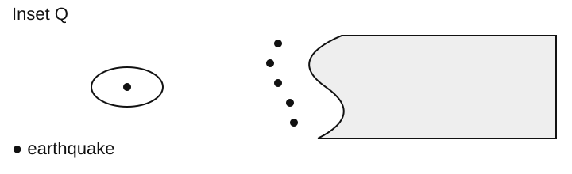

# Day 77: Where do the dots gather?

## Teacher page

### Before class

Read teacher-only-exit-key.md. Print unit 5 family note, movable feature and question strips, one-item half slips and student pages. Cover the Exit box and Q. Prepare event-only Map fallback U overlays: seven earthquake dots, three land volcano triangles, no mountain triangles. Show relief separately. Set unit 5 record sheet. Return day 76 notes. Ask clay allergies and pretest tomorrow's adult slicing setup.

### Safety and set-up

Paper only today. Discuss mapped places, never children's disaster experiences. Public talk may be passed.

### The day

#### 10 min. Hook

Keep day 76's promised map opening. Hand back day 76's written task, fresh transfer and revised checks without a repair round. Announce: "Map U is invented for practice, not a real world catalog." Reveal earthquake, then volcano symbols. An earthquake is ground shaking; a volcano is an opening where erupted material reaches the surface. Introduce belt: a cluster following a band, with possible exceptions. Alone, [[s05-P77-1]]. Retain notices before explanations. Error G: compare a crowded and empty area, without drawing a class pattern yet.

#### 3 min. Physical-map retrieval

Review key: a box that tells what each mark means, from grade 2. Uncover only mountain and ocean labels on relief U. **Ask.** [[s05-P77-2]]. Expect the labeled land triangles and water area. All point simultaneously. A miss matches each mark to its own key. Do not assume another subject taught this.

#### 15 min. Initial representations

Review patterns from day 42 and evidence-linked representations from day 70. Establish a fresh map display. Alone, [[s05-P77-3]]; pairs arrange strips on the shared outline, adding a symbol key. Teacher copies placements, retaining conflicting evidence. Children do not complete inset observations followed by a sketch. Separate event layers; similar positions do not show why events occur.

#### 12 min. Question board

Review question board: notices become questions, from grade 3 day 1. Each child completes [[s05-P77-4]]. Pairs each take 45 seconds to share. Hear rotating six, 45 seconds each, 4.5 minutes; group all thirty slips in remaining time. Teacher draws the tentative class model from strips. Keep uncertainties visible. All return their notice page, strips and question; no initial-model category or points.

#### 5 min. Exit ticket

Uncover Side 2's diagram and Exit box. Give the one-item half slip. Read [[s05-X77-observe]] neutrally; children mark its inset on Side 2. Then complete [[s05-X77-model]] in the Exit box. Four minutes alone; one to collect both papers. Keep the initial model unscored.

### Other rooms

No projector: use desk copies. No printer: copy U and keys on the board; draw Q on separate folded paper, concealed until exit.

### At home

**Swap.** Copy maps without a printer; point at desk copies without a projector. Use loose paper for strips.

**Skip.** Public sharing and the class board.

- **8 min. Notice.** Show U's separate layers. Say they are invented. Do [[s05-P77-1]].
  **Say.** "Where do dots gather?" Expect a located band, not an even scatter.
- **3 min. Key.** Do [[s05-P77-2]].
- **12 min. Strips.** Do [[s05-P77-3]], placing the strip beside its evidence.
- **7 min. Questions.** Do [[s05-P77-4]]. Adult arranges a tentative display.
- **5 min. Exit ticket.** Reveal Q. Uncover the Exit box. Child answers [[s05-X77-observe]] and [[s05-X77-model]] alone.

### Shorter or longer

Shorten public sharing, retaining every child's question and exit. Extend with an unanswered map question.

### Words and supports

Belt, earthquake, volcano. Review key and pattern. Read neutrally; accept a child's dictated observation. Keep locators and symbols accessible.

### Tomorrow

Return the half slip and paper Exit box together on the named day below.

Practice receives notes only. After class, practice-page feedback adds 30 times 15 seconds, 7.5 minutes.

After class, allow 30 times 20 seconds, ten minutes, for observation feedback and model notes. Use only shown, shown with help, not yet seen for observations. Return every paper day 78. Error G goes to its first five clay minutes. Day 76 water-readiness response stays in day 78's opening ten minutes. Strips/questions return with notes there, then stay in folders.

### Credit

Ours. Source U5-own supplies invented maps; Source U5-map supplies Earth-map background.

## Student page

### Side 1

I can find map patterns and ask questions about them.

Map U is invented for practice.

**Notice.** [[s05-P77-1]]

{small}

**Key.** [[s05-P77-2]]

**Strip.** [[s05-P77-3]]

| Observation strip | Place and layer |
|---|---|
| | |

### Side 2

**Question.** [[s05-P77-4]]

{work}

Keep your page for the covered Exit box. Hand everything in during Exit ticket.

**Exit box.** Keep this covered until Exit ticket.

[[s05-X77-model]]

{tall}
