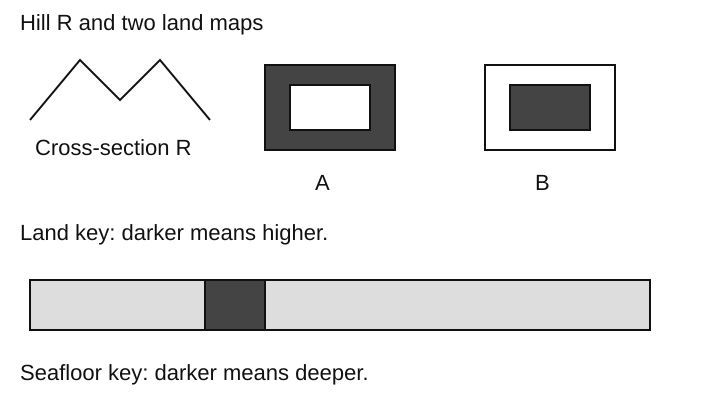

# Day 78: From a hill to a map

## Teacher page

### Before class

Read teacher-only-exit-key.md. Prepare display copies of water-state response cards and slice sequence and trace sheet, Map fallback U overlays and parallel repair packets. Print the one-item half slip. Cover Side 1's Exit box and diagram. Sort day 76 readiness and day 77 notes. Pretest a solid single-peaked clay hill and dry outlines that fit the trace boxes. Confirm allergies. Set modeling clay and blunt slicer on a tray, ruler, splash goggles and approved wipes/bags, adult handwashing supplies and unit 5 record sheet.

### Safety and set-up

Everyone wears goggles through setup, work and cleanup. Adult alone handles clay and blunt slicer, cutting away from hands. Children handle dry paper only. Nothing is eaten. Allergy route uses invented outlines, with firsthand work missing explicitly named.

### The day

#### 10 min. Water-location response

Return day 77's written task with notes, including notices, strips and questions.

Return day 76 readiness and day 77 strips/questions privately. Review grade 2 solid: water keeps its shape; liquid: water flows. First five minutes: [[s05-P78-1]]. Next five: review water locations from grade 2 days 7 and 8, reteaching any missing link, [[s05-P78-2]]. Use water-response.md's invented valley, river and lake, never the readiness map. Ready children distinguish ice-surface and underwater-ground keys. Missing evidence gets teaching, not a presumed pass.

#### 5 min. Land-water retrieval

Review make a model of land and water from grade 2 day 1. Alone, [[s05-P78-3]], using dry folded paper. A miss traces the lake edge before adding raised land. Adult prepares apparatus; no child handling queue.

#### 15 min. Clay and topography

Return day 77's exit tickets. If many show error G, first five minutes use [[s05-P78-4]] from the parallel repair packets while adult finishes setup. Then teach topography: surface shapes and heights. Demonstrate [[s05-K78-1]]; children trace three dry outlines on Side 2. Display the shared slice sequence and trace sheet.

[[steps:s05-K78-1]]

Explain elevation as height relative to sea level; depth as distance below water surface. Ridge is a raised chain; trench a long, narrow low seafloor feature. If slices smear, stop and announce the printed outline sequence is invented for practice. Leave actual-height cells blank. No fabricated measurement.

#### 5 min. Exit ticket

Use dry desks. Uncover Side 1's diagram and Exit box. Give the one-item half slip: [[s05-X78-land]]. Children answer [[s05-X78-depth]] in the Exit box. Four minutes independent paper work; one to collect both papers. No keys on children's pages.

#### 5 min. Seafloor comparison

**Ask.** [[s05-P78-5]]. Expect ridge/trench locators from their own key. Review key from yesterday. Pairs compare land height and underwater depth using U, 45 seconds each simultaneously. No named continent is needed on this invented map.

#### 5 min. Cleanup

Thirty children wipe and bag goggles simultaneously, one minute; file dry traces, one. Adult contains clay, cleans equipment and washes hands, three. No sink queue. Collect student pages, models and traces for feedback, returned day 79.

### Other rooms

No kit: use original invented outlines; say these are supplied evidence, not measurements. No printer/projector: adult copies separate outlines and U keys before class.

### At home

**Swap.** Without clay, goggles or slicing equipment, use invented outlines. Without printer or projector, copy diagrams. Use folded paper for land.

**Skip.** Public talk and group repair rounds.

- **8 min. Water.** Do [[s05-P78-1]] and [[s05-P78-2]].
  **Say.** "Can ice be water?" Expect yes, solid water.
- **5 min. Land.** Do [[s05-P78-3]].
- **12 min. Outlines.** Follow [[s05-K78-1]] with the invented sequence. Leave measurement cells blank.
- **5 min. Seafloor.** Do [[s05-P78-5]]. Put papers away.
- **5 min. Exit ticket.** Reveal R; uncover the Exit box; answer [[s05-X78-land]] and [[s05-X78-depth]] alone.

### Shorter or longer

Reduce extra traces, retaining readiness, model, key teaching, exit and cleanup. Extend by comparing different hills' outlines.

### Words and supports

Topography, contour, elevation, depth, ridge, trench. Raised paper and neutral reading preserve the task.

### Tomorrow

Return the half slip and paper Exit box together on the named day below.

Practice receives notes only. After class, practice-page feedback adds 30 times 15 seconds, 7.5 minutes.

After class: 30 times 20 seconds, ten minutes, to mark both exit parts on the unit 5 record sheet. Use shown, shown with help, not yet seen only. Return day 79 with traces/models. Error H uses separate keys; persistent error G traces U's cluster in its two five-minute Return and repair moves.

### Credit

Ours. Sources U5-own and U5-relief; Source U5-safety informs handling.

## Student page

### Side 1

I can use hill slices and map keys to read surface shapes.

**Water.** [[s05-P78-1]]

{small}

[[s05-P78-2]]

{small}

**Land and water.** [[s05-P78-3]]

{sketch}

**Exit box.** Keep this covered until Exit ticket.

[[s05-X78-depth]]

{work}

### Side 2

**Band.** [[s05-P78-4]]

**Slices.** [[s05-K78-1]]

Use the displayed slice sequence and trace sheet.

| Slice | Actual height, whole centimeters | My dry outline |
|---|---|---|
| Lower | | {tall} |
| Middle | | {tall} |
| Upper | | {tall} |

My higher/lower labels: ____________________

Leave actual heights blank for invented outlines.

**Seafloor.** [[s05-P78-5]]

Hand in your traces and paper model.
