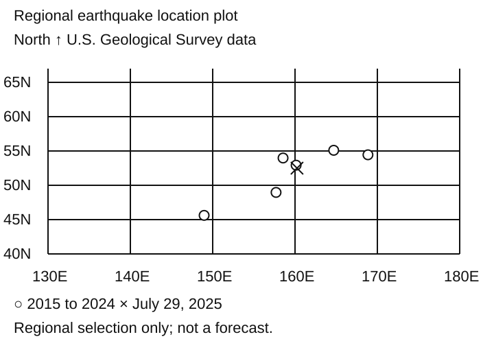
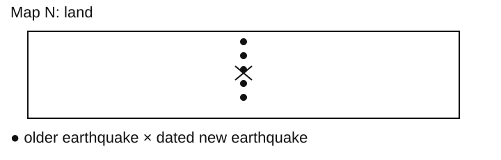

# Day 82: One event and a longer record

## Teacher page

### Before class

Read teacher-only-exit-key.md. Prepare unit 5 record sheet, Map fallback U overlays, parallel repair packets, day 81 evidence tags and dated event and older regional plots. Print the plot with today's short labels; keep event-extract.md's full coordinates teacher-side. Prepare three source-label slips from the student table. Cover Side 2's Exit box and diagram until Exit ticket. Freeze supplied records, with no classroom download or damage accounts.

### Safety and set-up

Paper only. No disaster images or personal/family disclosure. Public talk may be passed.

### The day

#### 10 min. Return and repair

Return day 81's written task with notes, including its student page and retained attachments.

Return day 81's exit ticket and evidence tags. If many show error B, first five minutes use [[s05-P82-1]]. Unresolved error C uses [[s05-P82-2]] in the next five. Review noncoastal evidence and record selection from days 80 and 81. Missing evidence gets a conference, not an assumed misconception.

#### 10 min. Locate the event

Read the dated official location record, July 29, 2025 near Kamchatka. The printed cross locates it; no magnitude arithmetic or decimal-coordinate calculation. Alone, [[s05-P82-3]]. Match the cross to the date key before any comparison. Teacher checks its near-160 E, between-50-and-55 N position. The grid shows locations, not a coastline. Do not label locations land/offshore from this plot alone.

If copies fail, announce Event fallback V is invented for practice, not a recent real event. Copy five circles in an ocean band and one cross within it. Label older practice years A to D, new practice year E; selected events only. Keep this alternate entirely separate from real dates/places. Use [[s05-P82-6]], not the real-plot question.

#### 15 min. Read source coverage

Review source: a page or picture giving information, from grade 2 day 6. Review short record, long record from grade 3 day 94. Partners position the new-event marker beside the older circles, without writing a comparison-and-limit answer. Each takes 45 seconds simultaneously to point. Then alone, [[s05-P82-4]], using date and selection slips. Correct a mismatch by rereading its source label. All return the source sort after Exit ticket for day 83 feedback. If using V, use [[s05-P82-7]] instead, with no real-event claim.

#### 5 min. Record limits

**Ask.** [[s05-P82-5]]. Children point to supported/beyond columns; hear rotating six, 30 seconds each, three minutes. Allow a pass. Review observation versus inference: an event's presence is evidence, not a forecast. Error C: point to the selection and geographic boundary. No paired written location-and-limit task before exit.

#### 5 min. Exit ticket

Uncover Side 2's diagram and Exit box. Give the one-item half slip: [[s05-X82-fit]]. Announce this record is invented for practice. Children answer [[s05-X82-limit]] in the Exit box. Four minutes alone; one to collect both papers. Accept any warranted one-event limit, not every limit in the teacher answer key.

### Other rooms

No printer/projector: copy the frozen plot and labels before class, keeping N separate and covered. Use only V if the real record cannot be copied accurately.

### At home

**Swap.** Copy the plot/labels without printer or projector. Paper labels replace slips; adult takes the partner role. Use invented V if accurate copying fails.

**Skip.** Public turns and a second repair route.

- **5 min. Repair.** Use [[s05-P82-2]] if needed.
- **8 min. Locate.** Do [[s05-P82-3]], or [[s05-P82-6]] for V.
- **12 min. Sort.** Do [[s05-P82-4]], or [[s05-P82-7]] for V.
  **Say.** "Which dates belong to the older source?" Expect 2015 through 2024, or A to D for invented V.
- **5 min. Limits.** Do [[s05-P82-5]] by pointing.
- **5 min. Exit ticket.** Reveal invented N; uncover the Exit box; answer [[s05-X82-fit]] and [[s05-X82-limit]] alone.

### Shorter or longer

Shorten partner turns, retaining location, source labels, limits and exit. Extend by proposing a record that would answer an unanswered question.

### Words and supports

Review key, source, observation, inference and record span. Enlarge the plotted cross. Read neutrally; a scribe records the child's chosen comparison.

### Tomorrow

Return the half slip and paper Exit box together on the named day below.

Practice receives notes only. After class, practice-page feedback adds 30 times 15 seconds, 7.5 minutes.

After class: 30 times 20 seconds, ten minutes, to mark both exit parts. Use shown, shown with help, not yet seen on unit 5 record sheet. Return day 83 with the source sort. Error C revisits what selection leaves unknown; error B locates noncoastal evidence, five minutes each. Then research ways to reduce hazard harm, not Earth mechanisms.

### Credit

Ours. Public-domain location data: U.S. Geological Survey, Sources U5-event and U5-older. Original plot by Curio Class. Source U5-own supplies invented alternatives.

## Student page

### Side 1

I can locate an event and compare records carefully.

**Repair.** [[s05-P82-1]]

[[s05-P82-2]]

**Dated regional plot.**

Event record: July 29, 2025, near Kamchatka.
Older extract: 2015 through 2024, magnitude at least 7.
Selected region: 40 to 65 N; 130 to 180 E.
Downloaded November 23, 2026. Location data, not a forecast.

**Locate.** [[s05-P82-3]]

For an invented V copy only:

[[s05-P82-6]]

### Side 2

**Sort.** [[s05-P82-4]]

| Label | Event record or older extract |
|---|---|
| July 2025 | |
| 2015 through 2024 | |
| Magnitude at least 7 | |

For an invented V copy only:

[[s05-P82-7]]

Older label: __________ New label: __________

**Claims.** [[s05-P82-5]]

- The older plot contains several events.
- An earthquake will repeat here tomorrow.
- Outside the plot is safe.

Point to: supported / beyond this record.

Hand in this page after Exit ticket.

**Exit box.** Keep this covered until Exit ticket.

[[s05-X82-limit]]

{work}
