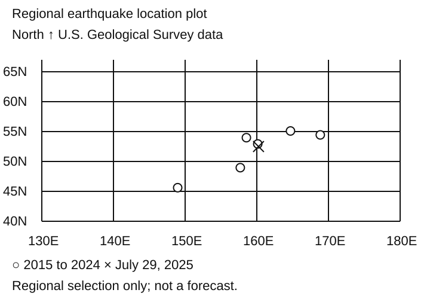

# Dated event and older regional extract

Official location record. Read only location, date and selection labels.

Event: July 29, 2025, near Kamchatka; 52.4948 N, 160.2395 E.

Older regional extract: 2015 through 2024, magnitude at least 7.
Bounds: 40 to 65 N, 130 to 180 E. Downloaded November 23, 2026.

| UTC date | Latitude N | Longitude E |
|---|---|---|
| 2016-01-30 | 53.9776 | 158.5463 |
| 2017-07-17 | 54.4434 | 168.857 |
| 2018-12-20 | 55.0999 | 164.6993 |
| 2020-02-13 | 45.6161 | 148.959 |
| 2020-03-25 | 48.9638 | 157.6955 |
| 2024-08-17 | 52.9308 | 160.1331 |

Credit: U.S. Geological Survey, public-domain catalog data. Original plot by Curio Class.
Sources U5-event/U5-older in sources.csv give exact queries; no damage information is included.

| Source-label sort | Event record or older extract |
|---|---|
| July 2025 | __________ |
| 2015 through 2024 | __________ |
| Magnitude at least 7 | __________ |

## Missing-copy alternative

Event fallback V is invented for practice, not a recent real earthquake.
Teaching-map ocean belt: ○ ○ ○ ○ ○. New event: × within that belt.
Keep V separate from real data. No real place or date is attributed to V.
