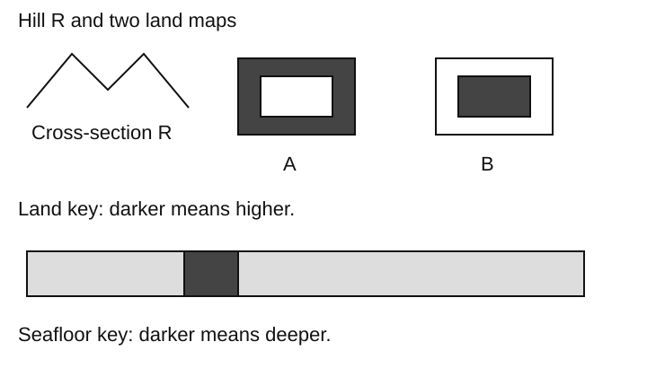

# Day 78 exit ticket

Name: ____________________ Date: __________

**1.** Invented for practice. Hill R has a high rim and low center. Land key: darker means higher. Map A has a dark rim; map B has a dark center. Separate seafloor key: darker means deeper. Choose and label the matching land map.

**2.** Use the same record. Explain the dark seafloor strip using its key.

____________________________________________________

____________________________________________________
