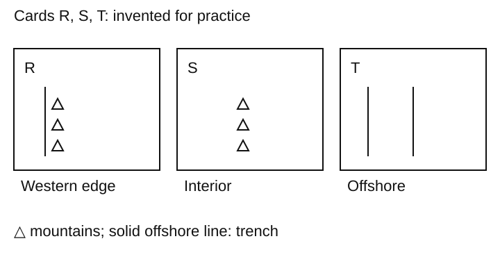

# Day 79 exit ticket

Name: ____________________ Date: __________

**1.** Invented for practice. Card R shows mountains along a western continental edge. Card S shows mountains inside another continent. Card T shows an offshore trench. Table the cards' locations and features.

| Feature | Location |
|---|---|
| ______ | ______ |
| ______ | ______ |
| ______ | ______ |

**2.** Use the same record. Describe the pattern those cards support.

____________________________________________________

____________________________________________________
