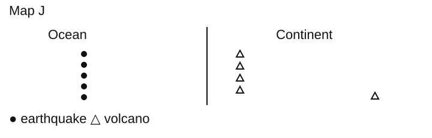

# Day 80 exit ticket

Name: ____________________ Date: __________

**1.** Invented for practice. Map J shows an ocean earthquake chain and a continental volcano chain. One volcano lies away from that chain. Add the observations to the feature/location table.

| Feature | Location |
|---|---|
| ______ | ______ |
| ______ | ______ |
| ______ | ______ |

**2.** Use the same record. Describe a supported pattern that needs an exception.

____________________________________________________

____________________________________________________
