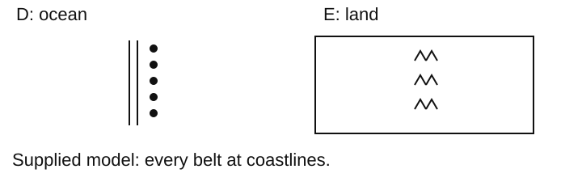

# Day 81 exit ticket

Name: ____________________ Date: __________

**1.** Invented for practice. Map D shows earthquakes along an ocean ridge. Map E shows an interior mountain belt. The supplied model puts every belt at coastlines. Revise that model using evidence from both maps.

____________________________________________________
