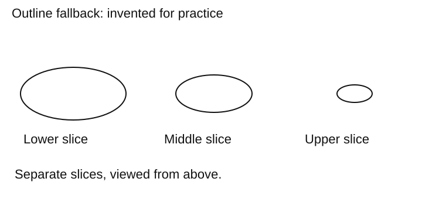

# Slice sequence and trace record

Name: __________________ Date: __________

Evidence: actual trace / invented outline fallback.

| Slice | Actual height in whole centimeters | Trace |
|---|---|---|
| Lower | ______ | 

 |
| Middle | ______ | 

 |
| Upper | ______ | 

 |

The ruler step is one centimeter. Leave actual heights blank for invented outlines.

Higher/lower labels: ______________________________________

| Dry hill/lake model | My key |
|---|---|
| 

 | __________________ |
