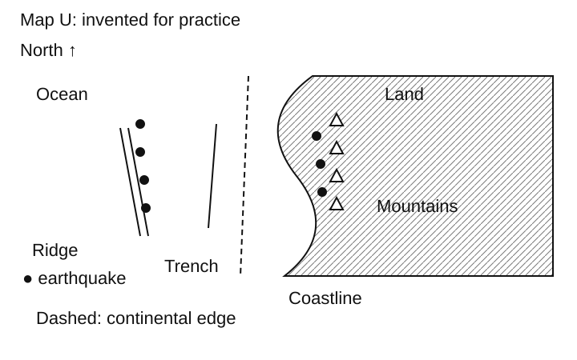
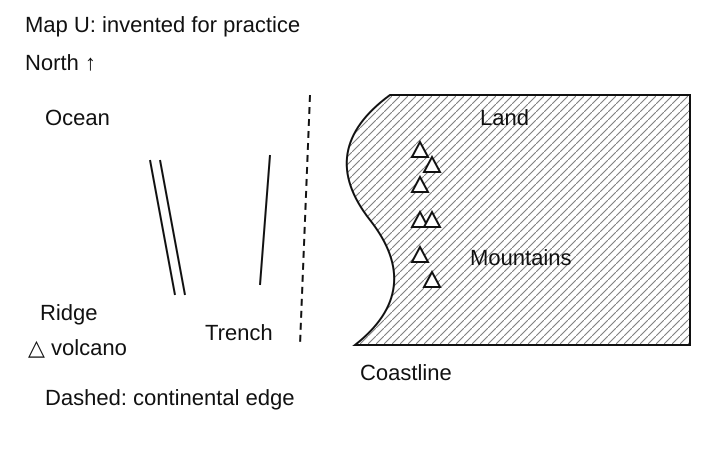
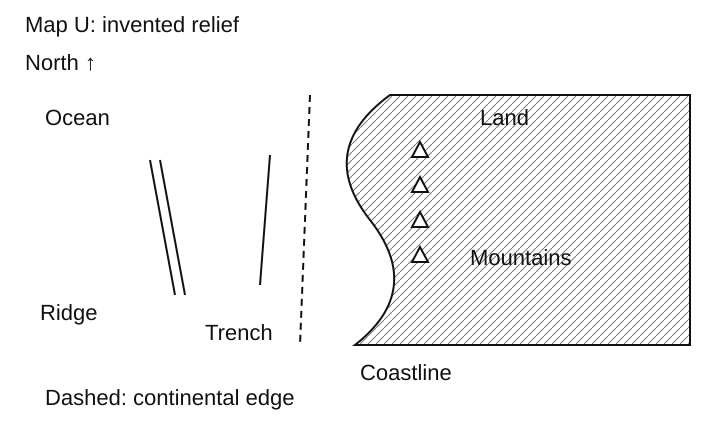
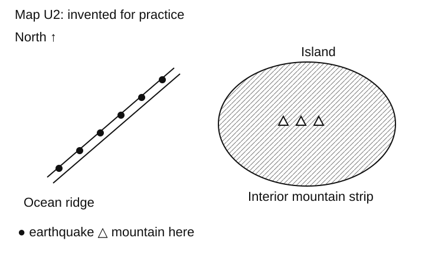

# Teaching maps and movable strips

Invented for practice. These are diagrams, not real world locations.

## Map U, day 77 onward

Map keys: round dots show earthquakes; open triangles show volcanoes on event layers.
The same outline and north direction apply to both layers.
Dates and size limits for these invented records: pretend years P to Q; selected events only.
They are not an extract of a real catalog.

## Relief layer, day 78 onward

Paired lines mark a ridge; a single solid offshore line marks a trench.
Mountain symbols on this relief layer show mountains, not volcano events.
Land key: tighter hatching means higher ground.
Seafloor key: tighter hatching means greater depth.
Keep each key beside its own layer.

## Movable strips

| Observation strip | Map/layer locator |
|---|---|
| __________________________ | ______________ |
| __________________________ | ______________ |
| __________________________ | ______________ |

| Question slip | Evidence tag |
|---|---|
| __________________________ | ______________ |
| __________________________ | ______________ |

## Unfamiliar pair, day 81 only

Use the event dots and relief marks as separate layers of one diagram.
Keep original class strips beside later evidence tags.
