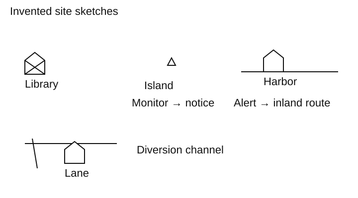

# Day 83: Actions that lessen hazard harm

## Teacher page

### Before class

Read teacher-only-exit-key.md. Prepare unit 5 record sheet, eight hazard research cards, cause and action strips and parallel repair packets. Return day 82 source sort, student written task, half slip and Exit box together. Cover today's reserved diagram and Exit box. Print only the first exit item on the half slip. Keys stay private.

### Safety and set-up

Paper only. No personal disaster accounts or simulated victims. Public talk may be passed.

### The day

#### 10 min. Return and repair

Return day 82's papers, including s05-X82-fit and s05-X82-limit, with their feedback inside this existing slot. Return day 82's source sort, student written task and both exit papers privately. If many show error C, five minutes on [[s05-P83-1]], using teaching U's selection label. Error B uses [[s05-P83-2]] and its noncoastal dots for five. Ready children check source locators. Review source: a page or picture giving information. Missing evidence gets a conference, not an error letter.

#### 5 min. Hazard retrieval

Review grade 3's hazard, harm, lessen: an event can hurt; harm is its effect; lessen means make smaller. Review hazard, design, harm arrows and criterion: a way to check the need is met. Review limit: the most we allow. Announce teaching T is invented for practice; use its stream/footpath strip. Alone, [[s05-P83-3]]. If needed, trace the route before choosing an observable outcome.

#### 20 min. Research teaching

Read eight hazard research cards, two per hazard, 90 seconds each. Eight minutes remain for notes, [[s05-P83-4]]. Each child chooses one pair; read its source locator too. Introduce braces and secure connections, monitoring, alert plus usable action, and diversion. Distinguish reduced damage/exposure from stopped events. Card pairs add evidence and limits to each other; no assumed reading routine. After the ask, model one volcano note using [[steps:s05-P83-4]]. Keep other hazards separate, never a four-site practice account. Check uncertain links by rereading the relevant card.

#### 5 min. Cause strips

Pairs restore one teaching chain, [[s05-P83-5]]. Hear rotating six volunteers, 30 seconds each, three minutes; others return annotations and strips on paper. Note heard names. Retain unanswered questions. Model evidence does not certify real buildings.

#### 5 min. Exit ticket

Uncover Side 2's reserved diagram. Announce invented for practice. Alone, [[s05-X83-harm]] on the one-item half slip and [[s05-X83-criterion]] in the Exit box. Four minutes answering; one collecting both. Read directions neutrally; accept labelled drawings or scribed child wording.

### Other rooms

No printer/projector: copy today's texts and blank records beforehand; cover reserved work. Use the named invented fallback if safe observation is unavailable, noting missing practical evidence.

### At home

**Swap.** Without printer or projector, copy the short records and covered diagram. Paper replaces strips; adult reads cards.

**Skip.** Public turns and a second repair route.

- **5 min. Review.** Use [[s05-P83-3]] with the footpath strip.
- **15 min. Research.** Read the card pairs. Child does [[s05-P83-4]] for one pair.
  **Say.** "What can monitoring change?" Expect information for protective action, not a stopped eruption.
- **10 min. Connect.** Child does [[s05-P83-5]] on one paper strip.
- **5 min. Exit ticket.** Reveal the reserved diagram. Child answers [[s05-X83-harm]] and [[s05-X83-criterion]] alone.

### Shorter or longer

Shorten public sharing, retaining repairs, evidence and exit. Extend by naming an untested condition.

### Words and supports

Review hazard, harm, lessen, criterion, limit and source. New: braces, monitor, alert, diversion. Read cards aloud; enlarge diagrams. A neutral scribe records the child's ideas.

### Tomorrow

Return the student written task with descriptive notes. Practice feedback after class: 30 times 15 seconds, 7.5 minutes. Mark both exit responses: 30 times 30 seconds, 15 minutes. Use shown, shown with help, not yet seen on unit 5 record sheet. Note language or missing evidence separately.

Return source annotations, strips and both exit papers on day 84. Error F restores delivery/action after information; unresolved error C revisits selected coverage, five minutes each. Then generate alternatives for teaching T.

### Credit

Ours. Original teaching records are invented for practice, Source U5-own.

## Student page

### Side 1

**I can use sources to explain how protection may lessen harm.**

**Repair.** [[s05-P83-1]]

[[s05-P83-2]]

**Review.** [[s05-P83-3]]

**Research.** [[s05-P83-4]]

| Card locator | Action | Possible effect | Limit |
|---|---|---|---|
| | | | |

**Connect.** [[s05-P83-5]]

Use your cause and action strip.

### Side 2

**Exit box.** Keep covered until Exit ticket.

[[s05-X83-criterion]]

{work}

Hand in both exit papers and your source annotations.
