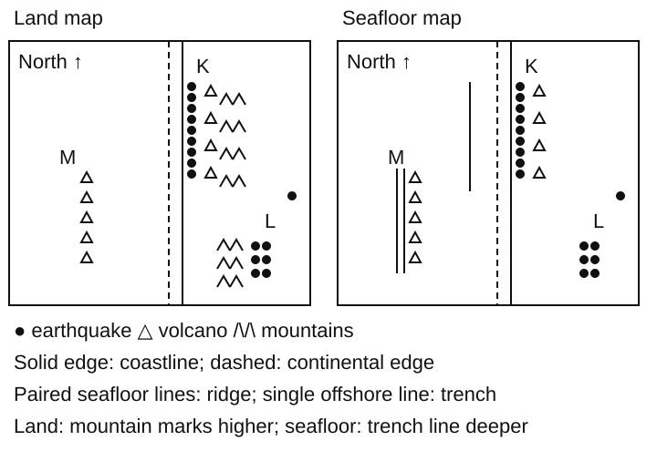

# Unit 5 end-of-unit assessment

Name: ____________________ Date: __________

## Side 1: maps

Invented for practice. North is up; matching locations align across both maps.
Count repeated event symbols once. No dates or size cutoff are supplied.

Table the map observations.

Explain the map patterns, including an exception and one evidence limit.

| Region | Land/seafloor features | Earthquakes | Volcanoes |
|---|---|---|---|
| K | __________ | ____ | ____ |
| L | __________ | ____ | ____ |
| M | __________ | ____ | ____ |
| Other | __________ | ____ | ____ |

Patterns, model, exception and limit: ___________________________

____________________________________________________________

____________________________________________________________

## Side 2: solutions

Invented for practice. A coastal town has a river, uphill volcano and nearby earthquake belt.
Goal: less harm to people and buildings. Each package has at most eight tokens.

| Option | Tokens |
|---|---|
| Braces | 3 |
| River wall | 4 |
| Raise houses | 4 |
| Volcano monitoring/notices | 3 |
| Tsunami alert/inland route | 2 |

Matched trials:

| Buildings standing /4 | Gentle | Stronger |
|---|---|---|
| Braced | 4 | 3 |
| Unbraced | 4 | 0 |

| Houses dry /5 | Small flow | Larger flow |
|---|---|---|
| Wall | 5 | 5 |
| Raised | 4 | 1 |
| Unprotected | 2 | 0 |

Monitoring covers the whole volcano.
Its notices use a town-hall loudspeaker; far farms cannot hear it.
The tsunami alert reaches the waterfront.
Its only inland route crosses the river, which rises in larger flow.

Use no more than eight tokens per package. Compare three packages in a recommendation covering tests, warning gaps, improvements and remaining risk.

| Package | Tokens | Evidence | Uncovered hazard |
|---|---|---|---|
| __________ | ____ | __________ | __________ |
| __________ | ____ | __________ | __________ |
| __________ | ____ | __________ | __________ |

Recommendation, improvement and remaining risk: __________________

____________________________________________________________

____________________________________________________________
