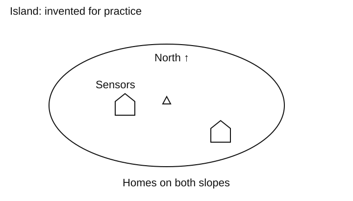

# Day 89 exit ticket

Name: ____________________ Date: __________

**1.** Invented for practice. Island homes occupy both volcano slopes; sensors cover only the north. Tsunami arrival: twelve minutes after the event. Alert delay: six minutes; travel to safe ground: eight minutes after the alert. Show whether this alert leaves enough time to reach safe ground.

____________________________________________________

**2.** Use the same record. Name one monitoring gap.

____________________________________________________

____________________________________________________
