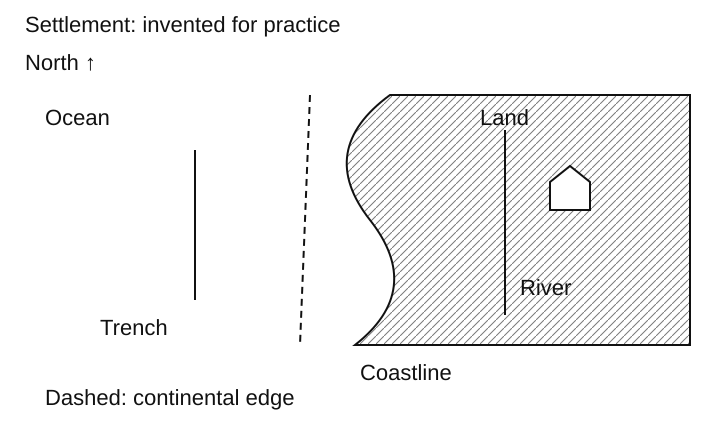

# Day 90 exit ticket

Name: ____________________ Date: __________

**1.** Invented for practice. A river settlement lies beside an offshore trench. Larger flow overtops its wall; raised models stay dry. Argue for one combination of solutions in two sentences, including one tradeoff.

____________________________________________________

____________________________________________________
