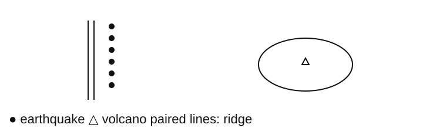

# Day 91 exit ticket

Name: ____________________ Date: __________

**1.** Invented for practice. An ocean-island map shows earthquakes along a ridge and one off-belt volcano. A protective model succeeds at low flow but fails at increased flow. Explain the mapped belt pattern, including its exception.

____________________________________________________

**2.** Use the same record. Explain what the higher-flow failure means for the protection claim.

____________________________________________________

____________________________________________________
