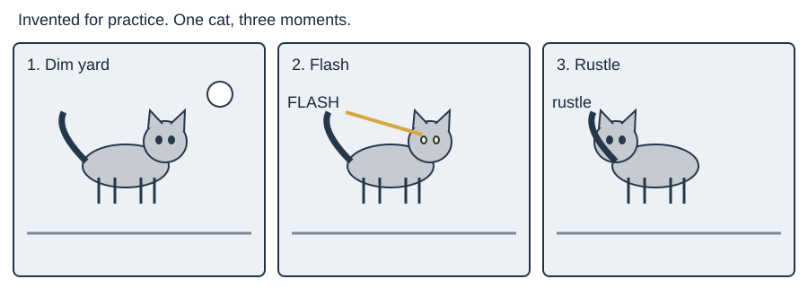

# Cat at night

Invented for practice. Pictures show one cat at three moments.

Can a cat see in complete darkness?

How does a plant get water, stay safe and spread its young?

[[s06-P94]]

________________________________________________________________

________________________________________________________________
Notice strip: __________________

Teacher: show on 94 without causal answers. On 97, U6-cat supplies reflection background.
On 113, revisit separate seeing and sensing questions.
