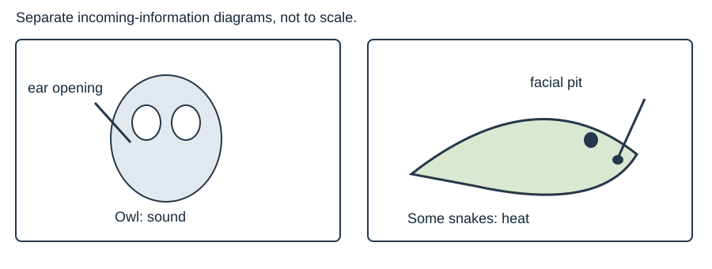

# Two incoming-information cards

Source-backed facts, with original schematic drawings.

## Card O

An owl can use hearing to locate a sound.

Receiving part: ______ Incoming information: ______

## Card H

Some snakes sense heat through pits on the face.

Not all snakes have these pits.

Receiving part: ______ Incoming information: ______

[[s06-P102]]

________________________________________________________________

________________________________________________________________
Teacher: read one card at a time. U6-owl and U6-snake supply facts.
No live animals, graphic scenes or two-record revision in practice.
