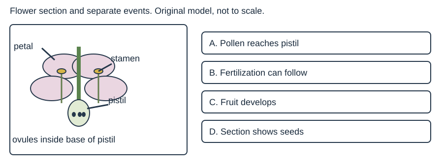

# Flower parts and separate event cards

Original source-backed model. Not every flower has all these parts.

| Part label | Supplied fact | My specimen or diagram label |
|---|---|---|
| Petal | May attract visitors | ______ |
| Stamen | Supplies pollen | ______ |
| Pistil | Contains ovules inside its ovary | ______ |
| Ovule | Can develop into a seed after fertilization | ______ |

An ovule label comes from the diagram, unless actually visible.

## Separate event cards

A: Pollen reaches the top of a pistil.
B: Fertilization can follow pollen transfer.
C: Ovules can develop into seeds; the ovary develops into fruit.
D: An original paper section shows seeds inside fruit.

[[s06-P108]]

My order: ___ ___ ___ ___

Pollen is not a seed.

Teacher: U6-reproductive supplies facts. Adult dissects white snapdragon before class with goggles and blunt tweezers.
Six sealed sets fit six two-minute views plus three setup minutes.
Use diagrams for allergy concerns or unavailable identity/safety information.
Five-minute adult cleanup includes containers, tray, tweezers, surfaces and handwashing.
Label/order practice does not write the held cooperation-and-insufficiency explanation.
