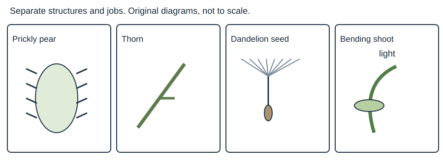

# Separate plant jobs

Source-backed facts. Original schematic drawings, not to scale.

## Card C

Prickly pear has shallow roots that collect rainfall.
Its pads store water. Spines help deter animals from eating it.

## Card T

Thorns can reduce damage from plant-eating animals.
A thorn is a modified branch. Not every sharp plant part is a thorn.

## Card D

Dandelion seeds can move with the wind.

## Card B

A shoot can bend toward light as it grows.
Plants do not need an animal brain for this response.

Day 105: [[s06-P105]]

Part: ______ Job: ______ Who it helps: ______

## Day 106 relevance cards

Invented observations for practice.

C1: A grazer stops at sharp cactus spines.
D1: A dandelion seed moves in the wind.

Claims: spines help deter eating; seed structures aid dispersal.

[[s06-P106]]

Claim: ______ Supporting card: ______

Teacher: use one job or claim at a time.
U6-cactus, U6-thorn, U6-dandelion and U6-bending supply facts.
No four-function synthesis, coiling tendril or seed-bearing burr case in practice.
