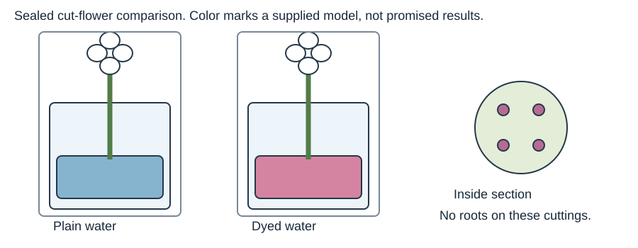

# Sealed plant comparison

Name: ______ Date: ______ Evidence: observed / supplied

Day 104: [[s06-P104]]

| Specimen | Water condition | Before color | Later color or unclear |
|---|---|---|---|
| Flower A | Plain | ______ | ______ |
| Flower B | Dyed | ______ | ______ |

Day 107: [[s06-P107]]

Inside mark observed: ______ Source fact label: ______

Optional reach: ___ cm. Ruler steps: 1 cm; nearest whole centimeter.

## Plant P

Invented for practice. This is supplied, not observed by our class.

| Cut flower | Start | Later |
|---|---|---|
| Plain water | Uncolored | Uncolored |
| Dyed water | Uncolored | Inside colored bands above water |

The cut flowers have no roots.

Keep actual unclear readings before using P.

## Source card U

Roots can absorb water. Inside paths carry water through stems toward leaves.

Celery is a leaf stalk. Use a flower stem for a stem claim.

Teacher: U6-vegetative supplies U. P replaces failed color or spoiled pairs, never overwrites results.
Adult prepares/seals with splash goggles; children never open containers.
Check pollen/celery allergies and actual dye instructions first; otherwise use drawings.
On 104: six ninety-second views. On 107: six two-minute views plus three setup minutes.
Five-minute adult cleanup includes wiping and handwashing.
