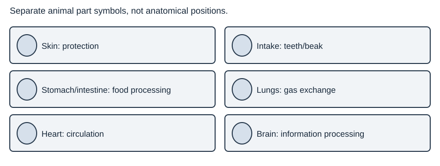

# Separate animal parts and jobs

Source-backed generic model, not a particular animal's anatomical layout.

| Card | Part | Supplied job |
|---|---|---|
| A | Skin | Helps protect the body |
| B | Teeth or beak | Take in food |
| C | Stomach and intestine | Process food; intestine takes in nutrients |
| D | Lungs | Exchange gases |
| E | Heart | Circulates blood carrying needed resources |
| F | Brain | Processes information and guides actions |

Day 109: [[s06-P109]]

Part: ______ Job: ______ One interacting part: ______

Teacher: present one part or resource route at a time.
General function facts: U6-structures, U6-heart, U6-lungs and U6-goat-digestion.
Use separate organ symbols, not a generic body outline pretending to verify species anatomy.
No complete goat, bird F, fox or sea-otter argument in practice.
