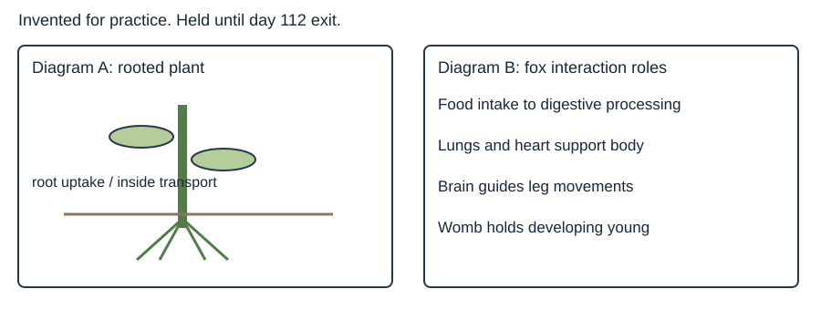

# Day 112 exit-only diagrams

Teacher: hold until the day 112 exit. No earlier practice uses these diagrams.

[[s06-X112]]

________________________________________________________

[[s06-X112-animal]]

________________________________________________________
