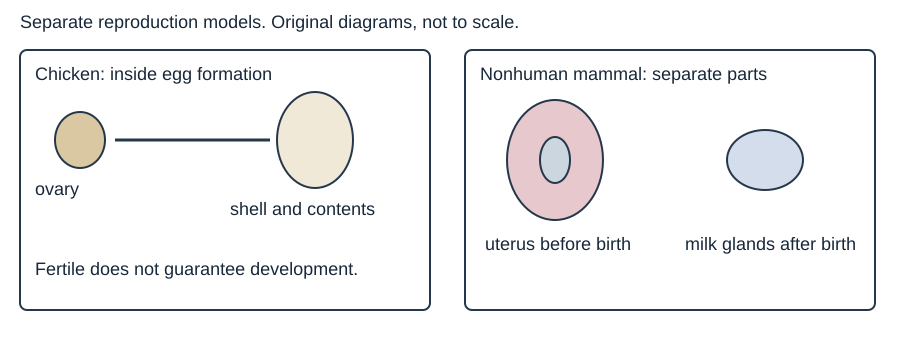

# Two separate reproduction models

Source-backed models. No human organs are shown.

## Chicken model

The ovary produces egg material.
Internal reproductive parts add the egg's other parts, including its shell.
A fertile egg can develop. Its contents nourish developing young; its shell helps protect them.
Not every egg develops successfully.

## Nonhuman mammal model

The uterus, also called womb, holds developing young before birth.
Milk glands provide nourishment after birth.
These are different structures with different jobs.

Card labels: ovary / egg / shell / contents / uterus / milk glands

Teacher: use five minutes for bird cards and five for mammal cards on 109.
U6-egg supplies chicken facts; U6-goat supplies the womb/milk-gland background.
Symbols are separated schematic organs, not species-specific anatomical positions.
Do not show the assessment sea otter or its growing-pup record.
