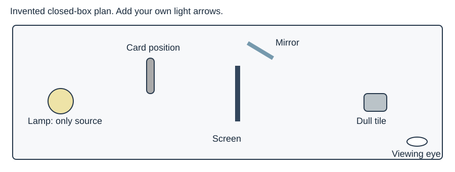

# Day 115: two model cases

Name: ______ Date: ______

Work alone. Keep first ideas visible. Open each flap only after its prediction.

## Seeing case: seventeen minutes

[[s06-E1-model]]

________________________________________________________________

________________________________________________________________
[[s06-E1-predict]]

________________________________________________________________

________________________________________________________________

Flap 1: open after prediction

[[s06-E1-test]]

________________________________________________________________

________________________________________________________________

## Sensing case: seventeen minutes

[[s06-E2-model]]

________________________________________________________________

________________________________________________________________
[[s06-E2-predict]]

________________________________________________________________

________________________________________________________________

Flap 2: open after prediction

[[s06-E2-test]]

________________________________________________________________

________________________________________________________________

Teacher printing: cover each flap with folded paper before handing out.
Launch three minutes; independent comparison five; collection three. No feedback or repair today.
