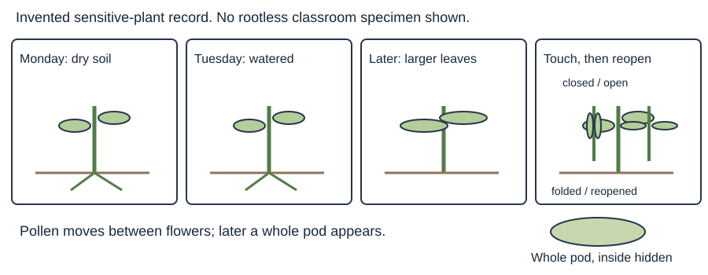
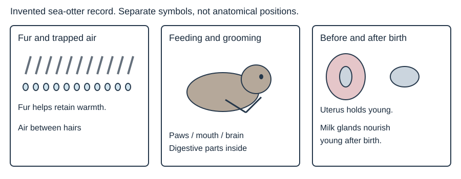

# Day 116: two structure arguments

Name: ______ Date: ______

Work alone. Use the supplied records. Keep the plant and animal arguments separate.

## Plant: eighteen minutes

[[s06-E3]]

________________________________________________________________

________________________________________________________________

________________________________________________________________

________________________________________________________________
## Animal: eighteen minutes

[[s06-E4]]

________________________________________________________________

________________________________________________________________

________________________________________________________________

________________________________________________________________
Teacher: neutral launch three minutes, independent review and collection six minutes.
No earlier work is scored. Yesterday's feedback stays held until 117.
No live plants, animals, tools or shared viewing turns today.
