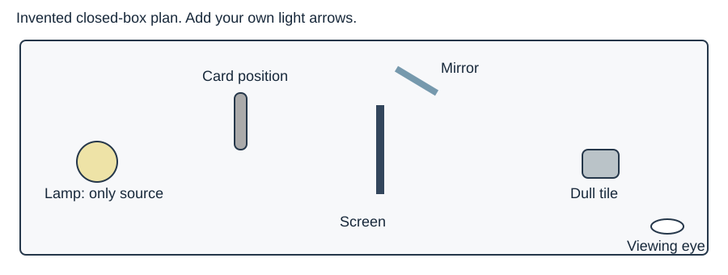

# Day 115: Two unfamiliar models

## Teacher page

### Before class

Read teacher-only answer keys and component record. Cover each test block with an opaque folded flap. Use this day's student page as print master, not the shared packet's teacher notes. Seat children for independent work. Cover teaching charts. Keep both teacher keys off student pages and display. No apparatus or new measurements; say these are invented records for practice.

### The day

#### 3 min. Launch

Honor day 114's handoff: s06-X114 stays private in the child's folder. No model review or ticket repair. Explain only response spaces, preserving first ideas and flap order. Read directions and labels neutrally. Children work alone. A reader or faithful scribe may help access without explaining scientific links.

#### 17 min. Item 1

Reveal Side 1's layout and [[s06-E1-model]], then [[s06-E1-predict]]. Allow eight minutes for modeling and four for prediction. After each child records a prediction, permit opening [[s06-E1-test]]; allow five minutes to test and revise or confirm. Read the evidence neutrally. No demonstration, peer comparison, hints or correctness feedback. Keep original arrows visible. The schematic mirror is aimed as stated; do not demand geometric angle calculations.

#### 17 min. Item 2

Reveal Side 2's [[s06-E2-model]] and [[s06-E2-predict]]. Allow eight minutes for the model and four for prediction. After prediction, open [[s06-E2-test]] for five minutes of evidence-linked testing. Keep changed experience distinct from changed odor in marking, without supplying that distinction during the assessment. Do not hear thirty sequential oral explanations; faithful individual paper responses preserve access.

#### 5 min. Independent comparison

Children independently review what their own arrows mean in each model. They may clarify labels or add evidence links without erasing first ideas. No partner discussion, answer display or teaching. This review adds no scored item.

#### 3 min. Collection

Collect both sides with flap responses and any scribed originals. Check identifiers and completion opportunities privately. Mark after class: thirty papers at two minutes each, sixty minutes. Use only assessment-record.md's 0/1/2 component scale, twenty points. Case 2 prediction and test combine into one two-point component. Keep descriptive access notes separate. Mark reversed source arrows as error A, missing illumination as B, transmission through opaque card as I, bypassed brain as D and denied learned meaning as E only when explicitly shown.

### Other rooms

No printer: copy exact stems and layout onto two sheets; cover evidence tests. Read neutrally. Each child keeps an independent paper record.

### At home

**Swap.** Copy the layout and exact stems if printing is unavailable. Cover each evidence test.

**Skip.** Class seating and collection procedures.

- **40 min. The assessment.** Child completes [[s06-E1-model]], [[s06-E1-predict]], [[s06-E1-test]], [[s06-E2-model]], [[s06-E2-predict]] and [[s06-E2-test]] alone. Open each flap only after its prediction. Read without hints.
- **5 min. Keep.** Save first models and evidence-linked changes. Hold explanations for day 117.

### Shorter or longer

Preserve both independent cases and evidence reveals. Extra access time continues privately without teaching or extra questions.

### Words and supports

Review established access routines only. A faithful scribe records the child's links; no scientific sentence frame or model is supplied.

### Tomorrow

Hold day 115's assessment and all feedback until day 117 Return feedback. Day 116 uses new plant and animal arguments with no reteaching.

### Credit

Ours. Background: Sources U6-seeing and U6-sensing.

## Student page

### Side 1

I can develop and test a seeing model.

Work alone. Keep first ideas visible.

The mirror is aimed to light the tile.
The diagram is not to scale.

1. [[s06-E1-model]]

{small}

2. [[s06-E1-predict]]

______________________________

______________________________

Keep the next block covered until your prediction is recorded.

3. [[s06-E1-test]]

______________________________

______________________________

### Side 2

I can test an information model.

4. [[s06-E2-model]]

{sketch}

5. [[s06-E2-predict]]

______________________________

______________________________

Keep the next block covered until your prediction is recorded.

6. [[s06-E2-test]]

______________________________

______________________________

Review your own arrow labels. Hand in both sides.
