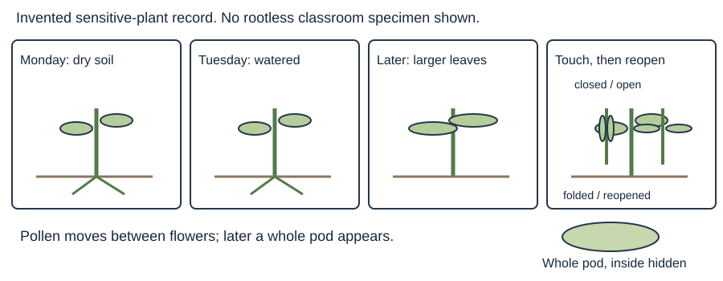
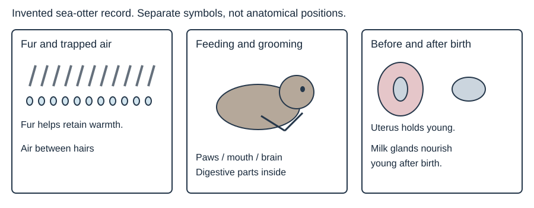

# Day 116: Two structure arguments

## Teacher page

### Before class

Read teacher-only answer keys and component record. Print this day's student page as the packet, without shared-packet teacher notes. Keep day 115's assessment and all feedback held until day 117. Cover teaching charts and separate children for independent work. Records and diagrams are invented for practice with source-backed anatomy. No plants or animals are handled.

### The day

#### 3 min. Launch

Honor day 115's handoff: no model review, feedback or repair today. Show only where responses go and explain independent work. Read exact directions and labels neutrally. Retain already established access supports; do not supply scientific links or an argument frame.

#### 18 min. Item 3

Reveal the plant record and [[s06-E3]] together. Allow three minutes for reading and fifteen for the independent argument. A faithful scribe records only the child's explanation. Children may use connected labels or sentences, with enough evidence to express the argument. Do not question children individually or offer hints. Reserve interpretation for marking.

#### 18 min. Item 4

Reveal the animal record and [[s06-E4]]. Allow three minutes to read and fifteen to respond independently. Read labels without interpreting them. The organ symbols show separate parts, not their precise anatomical positions. Do not show familiar teaching cards, other children's responses or the teacher-only answer key.

#### 6 min. Review and collection

Allow four minutes to review task parts independently and two to collect both arguments. No peer check or answers display. Mark afterward: thirty papers at two minutes each, sixty minutes. Use only 0/1/2 for each of six components per organism, twenty-four points, on assessment-record.md. Assess survival, growth, behavior, reproduction, interactions, and relevant evidence with a limit separately. Folding shows behavior; protection remains unproved by these records. A whole pod does not reveal seeds. Do not require either unsupported claim. Error F excludes inside structures; error G credits petals alone. Other missing functions receive descriptive feedback.

### Other rooms

No printer: copy exact stems and diagrams on separate sheets. Read labels and records neutrally. Keep individual paper responses.

### At home

**Swap.** Copy both records and diagrams if printing is unavailable.

**Skip.** Class seating and collection procedures.

- **40 min. The assessment.** Read supplied records neutrally. Child completes [[s06-E3]] and [[s06-E4]] independently. Give no hints or scientific links. A faithful scribe may write the child's explanation.
- **5 min. Keep.** Store both arguments with day 115's work. Hold discussion until day 117.

### Shorter or longer

Preserve both independent arguments. Extend access time privately if needed, keeping the same tasks and neutral administration.

### Words and supports

Use established reading, enlarged-print, home-language and faithful-scribe supports. Scientific terms and four-function labels were taught earlier; access does not replace evidence-linked explanation.

### Tomorrow

Day 117 returns day 115's assessment and day 116's assessment together. Route first missing components to light, sensing, plant or animal. Keep original component scores; repair and fresh explanations are separate records. No additional assessment or next-unit readiness is added.

### Credit

Ours. Background: Sources U6-vegetative, U6-reproductive, U6-sensitive, U6-otter and U6-otter-uterus.

## Student page

### Side 1

I can argue how plant parts work together.

Work alone. Use evidence from the record.

1. [[s06-E3]]

______________________________

______________________________

______________________________

______________________________

______________________________

______________________________

______________________________

______________________________

### Side 2

I can argue how animal parts work together.

2. [[s06-E4]]

______________________________

______________________________

______________________________

______________________________

______________________________

______________________________

______________________________

______________________________

Review your own arguments. Hand in both sides.
