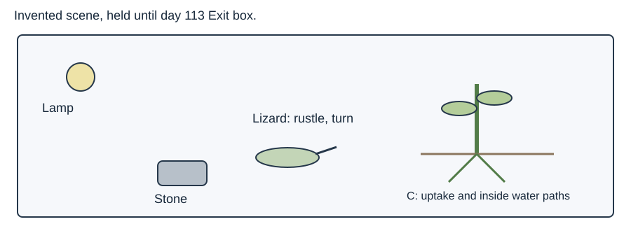

# Day 113 exit and Exit box

Teacher: hold until day 113 exit. Place the plant response on the student page.

Half slip:

[[s06-X113]]

________________________________________________________

[[s06-X113-response]]

________________________________________________________

Student page Exit box:

[[s06-P113-plant]]

________________________________________________________
