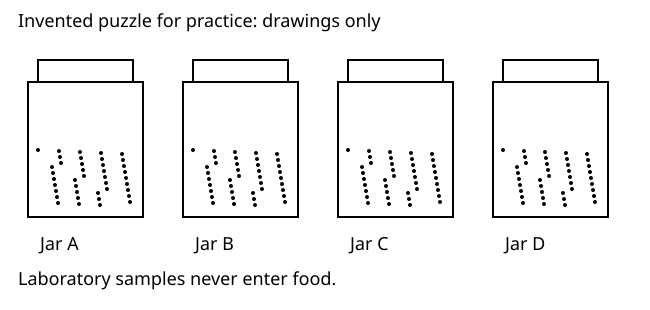

# Lookalike jars

Invented puzzle for practice. These are drawings, not food choices.

Laboratory samples never enter food.

[[s03-P45q]]

A question I have: ______________________________________________
