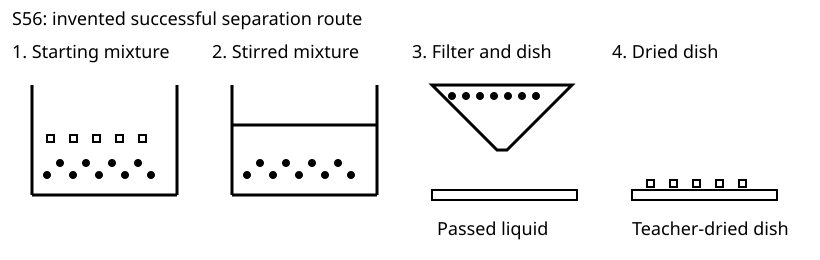

# One successful separation route

Invented for practice: S56. Each panel shows one stage.

No heating occurs in class. The teacher supplies the matching dried dish.

[[s03-P56]]

My one-material route: ____________________________________________

Filter: __________ Filtrate: __________ Residue: __________
