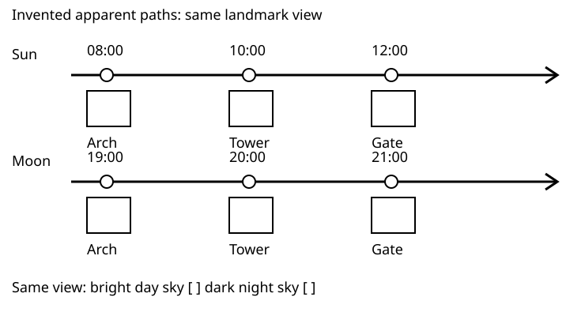

# Invented motion, sky and daylight records

All drawings and numbers are invented for practice.

## Whole-day daylight strips

Each symbol represents one hour. Light = o. Dark = x.

Winter: oooooooo xxxxxxxxxxxxxxxx

Spring: ooooooooooooo xxxxxxxxxxx

Summer: oooooooooooooooo xxxxxxxx

Shortest daylight season: __________ Evidence: _____________________
