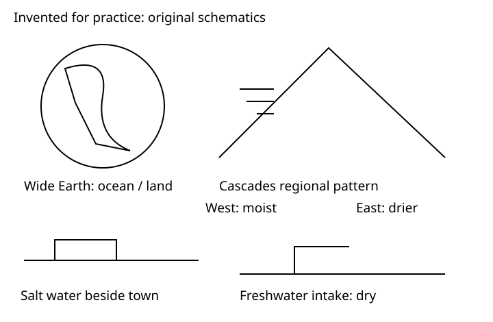

# Wide Earth, contrasting slopes

The Earth photograph was taken on December 7, 1972.
[Earth photograph and credit](https://science.nasa.gov/resource/the-blue-marble/).
Image credit: NASA Johnson Space Center, AS17-148-22727.

The drawings are schematics, not photographs or measured rainfall records.
North Cascades records describe a moist marine west and a drier east.
The invented town beside salt water has a dry freshwater intake.
This town is invented for practice, not a report of any community.

[[s05-P85]]

________________________________________________________________

________________________________________________________________

________________________________________________________________
