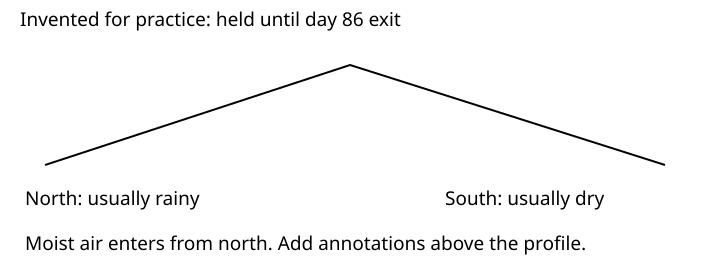

# Section 5.1: covered independent paper

Keep covered until independent work. Print one day only.
Each record headed invented is invented for practice.

## Day 85

[[s05-X85]]

| Model |
| --- |
| &nbsp; |
| &nbsp; |
| &nbsp; |
| &nbsp; |
| &nbsp; |
| &nbsp; |

## Day 86

[[s05-X86-1]]

[[s05-X86-2]]

_______________________________

## Day 87

[[s05-X87]]

________________________________________________________________

________________________________________________________________

________________________________________________________________

## Day 88

[[s05-X88-1]]

________________________________________________________________

________________________________________________________________

________________________________________________________________

[[s05-X88-2]]

________________________________________________________________

________________________________________________________________

________________________________________________________________

### Student-page Exit box, not a third ticket item

[[s05-X88-3]]

________________________________________________________________

________________________________________________________________

________________________________________________________________
